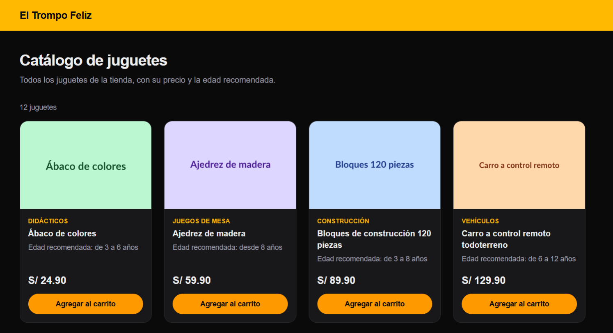
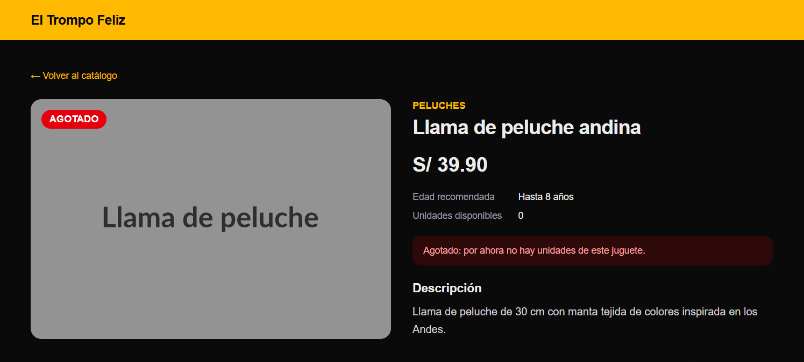
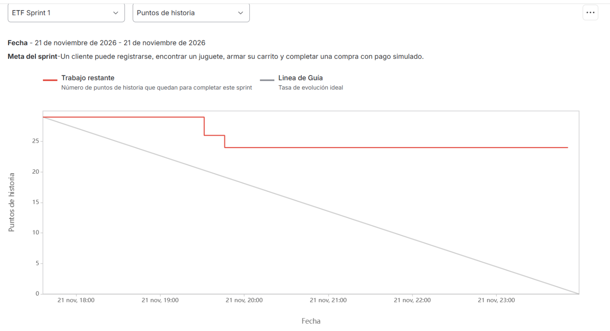
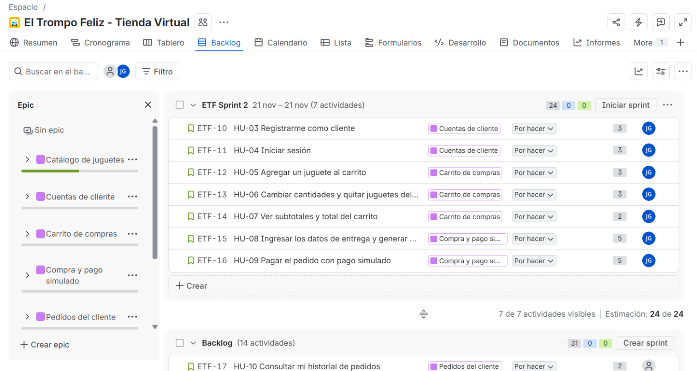

# Sprint Review: Sprint 1

**Producto:** Tienda virtual de juguetes «El Trompo Feliz»  
**Sprint:** ETF Sprint 1 (Jira, espacio `ETF`)  
**Fecha del sprint:** 21/11/2026. Se inició a las 17:36 y se cerró en Jira a las 23:52.  
**Fecha de la Review:** al cerrar el sprint, en la noche del 21 al 22/11/2026.  
**Equipo Scrum:** José Luis Rivera Gonzales (Product Owner, Scrum Master y Developer)  
**Partes interesadas:** el docente del curso, que tiene acceso al tablero de Jira, al repositorio y a la tienda publicada.

La Retrospectiva de este sprint está en [`sprint-1-retrospectiva.md`](sprint-1-retrospectiva.md).

---

## 1. Meta del sprint y resultado

> «Un cliente puede registrarse, encontrar un juguete, armar su carrito y completar una compra con pago simulado».

**Resultado: la meta no se cumplió.** Hoy un visitante puede **encontrar un juguete** en el catálogo publicado y ver su detalle, pero todavía no puede registrarse, armar su carrito ni pagar. Esas historias (HU-03 a HU-09) pasan al Sprint 2.

El sprint sí dejó lista la base que necesitan las historias que faltan: el repositorio, la base de datos con datos semilla, el despliegue automático y 5 de los 9 diagramas UML, que ya fijan los nombres de las clases del registro, el carrito, los pedidos y el pago.

## 2. Lo comprometido y lo terminado

En el Sprint Planning se comprometieron 9 historias (29 puntos) y 5 tareas técnicas. Las tareas no llevan puntos (ver la sección 7 del [Product Backlog](product-backlog.md#7-tareas-técnicas)).

| Clave | ID | Actividad | Puntos | Estado al cierre |
|---|---|---|---|---|
| ETF-28 | T-01 | Crear la estructura del repositorio | — | Terminado |
| ETF-29 | T-02 | Conectar el backend a PostgreSQL (Neon) y cargar datos semilla | — | Terminado |
| ETF-30 | T-03 | Desplegar el frontend en Vercel y el backend en Render | — | Terminado |
| ETF-8 | HU-01 | Ver el catálogo de juguetes | 3 | Terminado |
| ETF-9 | HU-02 | Ver el detalle de un juguete | 2 | Terminado |
| ETF-31 | T-04 | Elaborar los modelos de requisitos y de análisis | — | Terminado |
| ETF-32 | T-05 | Elaborar el diagrama de clases de diseño y el de subsistemas | — | Terminado |
| ETF-10 | HU-03 | Registrarme como cliente | 3 | Pasa al Sprint 2 |
| ETF-11 | HU-04 | Iniciar sesión | 3 | Pasa al Sprint 2 |
| ETF-12 | HU-05 | Agregar un juguete al carrito | 3 | Pasa al Sprint 2 |
| ETF-13 | HU-06 | Cambiar cantidades y quitar juguetes del carrito | 3 | Pasa al Sprint 2 |
| ETF-14 | HU-07 | Ver subtotales y total del carrito | 2 | Pasa al Sprint 2 |
| ETF-15 | HU-08 | Ingresar los datos de entrega y generar el pedido | 5 | Pasa al Sprint 2 |
| ETF-16 | HU-09 | Pagar el pedido con pago simulado | 5 | Pasa al Sprint 2 |

**Resumen:** 7 de 14 actividades terminadas: 2 historias (5 puntos) y las 5 tareas. Quedan 7 historias (24 puntos).

## 3. Incremento

| Parte | Dirección pública |
|---|---|
| Tienda (frontend Next.js en Vercel) | https://el-trompo-feliz-jrivera.vercel.app |
| API (backend NestJS en Render) | https://el-trompo-feliz-api.onrender.com |

**Lo que se puede hacer hoy en la tienda:**

- Ver el catálogo con los 12 juguetes de la semilla: imagen, nombre, precio en soles, categoría y edad recomendada, ordenados según el alfabeto español.
- Reconocer los juguetes agotados por la etiqueta «Agotado».
- Entrar al detalle de un juguete haciendo clic en su tarjeta.
- Ver mensajes claros cuando la API tarda en despertar, cuando no responde, cuando no hay juguetes y cuando el juguete no existe.

**Rutas de la API:** `GET /`, `GET /salud` (estado del servicio y de la base de datos), `GET /juguetes` y `GET /juguetes/:id`.

**Modelos UML terminados** (en [`docs/uml`](../uml/README.md)): casos de uso, clases de análisis, paquetes, clases de diseño y subsistemas con interfaces.

Cada actividad se desarrolló en su propia rama y se integró a `main` con un pull request. Vercel y Render publican `main` de forma automática.

| PR | Clave | Contenido | Integrado |
|---|---|---|---|
| [#1](https://github.com/joseriverago/el-trompo-feliz/pull/1) | ETF-28 | Proyectos frontend y backend, README y documentos Scrum | 17:50 |
| [#2](https://github.com/joseriverago/el-trompo-feliz/pull/2) | ETF-29 | Conexión a Neon con TypeORM y datos semilla | 18:13 |
| [#3](https://github.com/joseriverago/el-trompo-feliz/pull/3) | ETF-30 | Preparación para desplegar en Vercel y Render | 18:22 |
| [#4](https://github.com/joseriverago/el-trompo-feliz/pull/4) | ETF-30 | URLs públicas en los README | 18:50 |
| [#5](https://github.com/joseriverago/el-trompo-feliz/pull/5) | ETF-30 | Dominio propio en Vercel | 19:01 |
| [#6](https://github.com/joseriverago/el-trompo-feliz/pull/6) | ETF-8 | Catálogo de juguetes | 19:23 |
| [#7](https://github.com/joseriverago/el-trompo-feliz/pull/7) | ETF-8 | Orden alfabético en español (error encontrado en producción) | 19:27 |
| [#8](https://github.com/joseriverago/el-trompo-feliz/pull/8) | ETF-9 | Detalle de un juguete | 19:42 |
| [#9](https://github.com/joseriverago/el-trompo-feliz/pull/9) | ETF-31 | Casos de uso, clases de análisis y paquetes | 23:39 |
| [#10](https://github.com/joseriverago/el-trompo-feliz/pull/10) | ETF-32 | Clases de diseño y subsistemas con interfaces | 23:47 |

## 4. Demostración contra los criterios de aceptación

El Product Owner revisó cada criterio en la tienda publicada. Para el catálogo vacío se usó una API simulada en local, porque la base de datos real tiene juguetes.

### HU-01 · Ver el catálogo de juguetes (ETF-8): aceptada

| Criterio | Resultado | Evidencia |
|---|---|---|
| 1. Cada juguete muestra imagen, nombre, precio (S/ con dos decimales), categoría y edad recomendada. | Cumple | [h01-05](../evidencias/sprint-1/h01-05-tienda-catalogo-fila-1.png), [h01-07](../evidencias/sprint-1/h01-07-tienda-catalogo-fila-3.png) |
| 2. Un juguete con stock 0 aparece con «Agotado» y sin el botón «Agregar al carrito». | Cumple | [h01-06](../evidencias/sprint-1/h01-06-tienda-catalogo-agotado.png), [h01-08](../evidencias/sprint-1/h01-08-api-juguetes-agotado.png) |
| 3. Sin juguetes, se ve «Por ahora no hay juguetes disponibles». | Cumple | [h01-02](../evidencias/sprint-1/h01-02-local-catalogo-vacio.png) |

**Observación:** el botón «Agregar al carrito» de los juguetes con stock todavía no hace nada. Los criterios de HU-01 no piden que funcione: lo conecta HU-05 (ETF-12), que está en el Sprint 2.

### HU-02 · Ver el detalle de un juguete (ETF-9): aceptada

| Criterio | Resultado | Evidencia |
|---|---|---|
| 1. Al hacer clic en un juguete se ve su detalle: imagen, nombre, descripción, precio, categoría, edad recomendada y unidades disponibles. | Cumple | [h02-04](../evidencias/sprint-1/h02-04-tienda-clic-en-tarjeta.png), [h02-05](../evidencias/sprint-1/h02-05-tienda-detalle-trompo.png) |
| 2. Con stock 0, el detalle muestra «Agotado» y no permite agregarlo al carrito. | Cumple | [h02-06](../evidencias/sprint-1/h02-06-tienda-detalle-agotado.png) |
| 3. Si el juguete no existe, se ve «Juguete no encontrado» y un enlace para volver al catálogo. | Cumple | [h02-07](../evidencias/sprint-1/h02-07-tienda-juguete-no-encontrado.png) |

  
  

## 5. Revisión de la Definición de Terminado

Se revisó la [Definición de Terminado](definicion-de-listo-y-terminado.md#definición-de-terminado-definition-of-done) para HU-01 y HU-02 antes de moverlas a Terminado:

| Punto de la DoD | HU-01 | HU-02 |
|---|---|---|
| Cumple todos sus criterios de aceptación | Sí | Sí |
| Valida en el navegador y en el servidor | No recibe datos del usuario; muestra mensajes claros si el catálogo está vacío o la API no responde | Sí: la API responde 404 si el id no existe o no es un número, y la página muestra «Juguete no encontrado» |
| Los datos vienen de PostgreSQL (Neon) | Sí | Sí |
| TypeScript y `npm run build` sin errores en frontend y backend | Sí | Sí |
| Rama propia y pull request | PR #6 y #7 | PR #8 |
| Commits con la clave de Jira | `ETF-8 …` | `ETF-9 …` |
| Sin contraseñas ni cadenas de conexión en el repositorio | Sí | Sí |
| Desplegado y verificado en la URL pública | Sí | Sí |
| Diagramas UML coherentes con el código | Sí: `listarCatalogo` en las clases de diseño (T-05) | Sí: `obtenerDetalle` en las clases de diseño (T-05) |
| En la columna Terminado de Jira | Sí | Sí |

El backend tiene **20 pruebas automatizadas** (Vitest) que pasan: datos semilla, orígenes de CORS, servicio de juguetes y controlador principal.

## 6. Burndown y velocidad

- El trabajo restante empieza en **29 puntos**. Baja a 26 al terminar HU-01 (cerca de las 19:30) y a **24** al terminar HU-02 (cerca de las 19:45).
- Después la línea queda plana hasta el cierre, aunque T-04 y T-05 se terminaron: las tareas no tienen puntos, así que su avance no se ve en el gráfico.
- **Velocidad real del Sprint 1: 5 puntos**, frente a los 30 previstos en el plan de entregas.

**Por qué la velocidad fue tan baja:** el sprint concentró el trabajo que solo se hace una vez (crear el repositorio, conectar la base de datos, desplegar) y el modelado UML. Según la hora de integración de los PR, las tres tareas de infraestructura se terminaron entre las 17:36 y las 19:01; HU-01 y HU-02, entre las 19:01 y las 19:42; y los diagramas, a las 23:39 y 23:47, después de una pausa. Ese trabajo ya no se repite en el Sprint 2. La retrospectiva propone cómo usar este dato en el Sprint 2 Planning.

## 7. Cambios en el Product Backlog

- **HU-03 a HU-09 (ETF-10 a ETF-16, 24 puntos)** pasaron al **ETF Sprint 2**, que Jira creó al cerrar el Sprint 1. El sprint está creado pero **sin iniciar**: sus fechas, su meta y el resto de su contenido se deciden en el Sprint 2 Planning del 22/11/2026.
- **Release v1.0 (Compra en línea):** no se publica todavía. Sus 2 primeras historias están terminadas y las 7 restantes pasan al Sprint 2, junto con la release v2.0.
- El Product Backlog no cambia de orden: el registro y el inicio de sesión (HU-03 y HU-04) siguen primero, porque el carrito y la compra necesitan un cliente con sesión iniciada.
- La sección 11 del [Product Backlog](product-backlog.md#11-plan-de-entregas) se actualizó con la velocidad real y el estado de v1.0.

## 8. Riesgos para el Sprint 2

| Riesgo | Qué se hará |
|---|---|
| Quedan 55 puntos (24 de v1.0 y 31 de v2.0) para un sprint de un día. | En el Sprint 2 Planning se compromete primero v1.0 y se suman historias de v2.0 por prioridad solo si hay capacidad. Lo que no entre queda en el Product Backlog. |
| Las tareas T-06, T-07 y T-08 (diagramas de secuencia, componentes, despliegue y evidencias) tampoco llevan puntos. | Se reserva tiempo para ellas en la capacidad del Sprint 2. |
| El servicio gratuito de Render se duerme tras 15 minutos sin visitas y la primera petición tarda alrededor de un minuto. | La tienda ya muestra un aviso mientras la API despierta. Antes de cada demostración se abre `/salud` para despertarla. |
