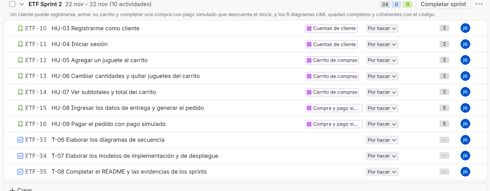
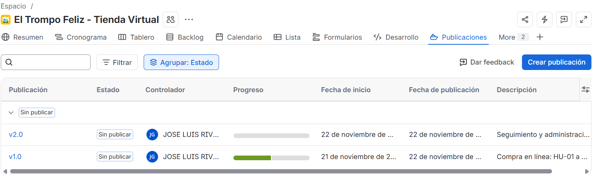

# Sprint Planning: Sprint 2

**Producto:** Tienda virtual de juguetes «El Trompo Feliz»  
**Sprint:** ETF Sprint 2 (Jira, espacio `ETF`)  
**Fecha:** 22/11/2026. El sprint se inició en Jira a las 00:16 y termina a las 23:59, sin cierre automático.  
**Equipo Scrum:** José Luis Rivera Gonzales (Product Owner, Scrum Master y Developer)

Este Sprint Planning aplica las acciones de la [Retrospectiva del Sprint 1](sprint-1-retrospectiva.md#3-acciones-para-el-sprint-2) y parte de los resultados de la [Sprint Review del Sprint 1](sprint-1-review.md).

---

## 1. Meta del sprint

> «Un cliente puede registrarse, armar su carrito y completar una compra con pago simulado que descuenta el stock, y los 9 diagramas UML quedan completos y coherentes con el código».

La meta completa la release **v1.0 (Compra en línea)**, que quedó a medias en el Sprint 1, y cierra el modelo UML con los diagramas de secuencia, componentes, artefactos y despliegue.

## 2. Capacidad

- **Capacidad declarada por el Developer:** de 10 a 11 horas de trabajo el 22/11/2026.
- **Velocidad del Sprint 1:** 5 puntos. No sirve sola para planificar, porque ese sprint se dedicó sobre todo a la infraestructura y al modelado, que no llevan puntos (ver la [Sprint Review](sprint-1-review.md#6-burndown-y-velocidad)).
- **Dato usado para estimar:** HU-01 y HU-02 (5 puntos) se programaron en unos 40 minutos. Las historias de este sprint tienen más reglas (contraseñas cifradas, sesión con JWT, validación de stock y una transacción de pago), así que se estimaron con más holgura y se sumó el tiempo de pruebas, verificación en la URL pública, capturas y Jira.

Como acordó la retrospectiva, las tareas técnicas se estiman en horas y su tiempo se descuenta de la capacidad antes de elegir historias.

## 3. Sprint Backlog

| Orden | Clave | ID | Actividad | Puntos | Horas estimadas |
|---|---|---|---|---|---|
| 1 | ETF-10 | HU-03 | Registrarme como cliente | 3 | 1 |
| 2 | ETF-11 | HU-04 | Iniciar sesión | 3 | 0,75 |
| 3 | ETF-12 | HU-05 | Agregar un juguete al carrito | 3 | 1 |
| 4 | ETF-13 | HU-06 | Cambiar cantidades y quitar juguetes del carrito | 3 | 0,75 |
| 5 | ETF-14 | HU-07 | Ver subtotales y total del carrito | 2 | 0,5 |
| 6 | ETF-15 | HU-08 | Ingresar los datos de entrega y generar el pedido | 5 | 1,25 |
| 7 | ETF-16 | HU-09 | Pagar el pedido con pago simulado | 5 | 1,25 |
| — | ETF-33 | T-06 | Elaborar los diagramas de secuencia | — | 1,5 |
| — | ETF-34 | T-07 | Elaborar los modelos de implementación y de despliegue | — | 1,5 |
| — | ETF-35 | T-08 | Completar el README y las evidencias de los sprints | — | 1 |
| | | | **Total** | **24** | **10,5** |

Las 10 horas y media estimadas caben en la capacidad declarada. Las 7 historias cumplen la [Definición de Listo](definicion-de-listo-y-terminado.md#definición-de-listo-definition-of-ready): ya estaban refinadas, estimadas y con sus criterios de aceptación desde el Sprint 1, y sus dependencias se resuelven dentro del mismo sprint.

## 4. Cómo se hará el trabajo

1. **Cuentas (HU-03 y HU-04).** Van primero porque el carrito y la compra necesitan un cliente con sesión iniciada. Se construyen `AuthService`, `UsuariosService`, `JwtAuthGuard` y las páginas de registro e inicio de sesión, con los nombres de las [clases de diseño](../uml/README.md).
2. **Carrito (HU-05 a HU-07).** `CarritoService` usa `IInventario` (`JuguetesService.verificarStock`) para no superar el stock. El diagrama de secuencia de **CU-07 Agregar producto al carrito** (T-06) se hace junto con HU-05.
3. **Compra y pago (HU-08 y HU-09).** `PedidosService.generarPedido` y `PagosService.pagar`, que en una sola transacción guarda el pago, descuenta el stock y marca el pedido Pagado. El diagrama de secuencia de **CU-09 Realizar compra** (T-06) se hace junto con estas historias.
4. **Resto del modelo (T-06 y T-07).** El diagrama de secuencia de **CU-12 Gestionar productos**, y los diagramas de componentes, artefactos y despliegue (descriptor e instancia), según el repositorio real y los servicios de Vercel, Render y Neon.
5. **Cierre (T-08).** README final, evidencias, burndown y velocidad, y después la Sprint Review y la Retrospectiva del Sprint 2.

Cada historia sigue el mismo flujo del Sprint 1: rama `feature/ETF-<número>-…`, commits con la clave de Jira, pull request, despliegue automático, prueba de los criterios en la URL pública y paso a Terminado en Jira con un comentario que enlaza el PR.

## 5. Acciones de la retrospectiva aplicadas

| Acción del Sprint 1 | Cómo se aplica en este planning |
|---|---|
| 1. Comprometer según la capacidad real | La capacidad (10 a 11 h) quedó escrita y lo comprometido (10,5 h) no la supera. |
| 2. Reservar tiempo para las tareas | T-06, T-07 y T-08 suman 4 h, descontadas antes de elegir historias. |
| 3. Construir en el orden de las dependencias | La columna «Orden» del Sprint Backlog sigue esa secuencia. |
| 4. Probar con datos en español y contra la base de datos real | Se revisa en la Sprint Review del Sprint 2, con las pruebas de HU-03 y HU-08. |
| 5. Hacer cada diagrama de secuencia junto con su historia | CU-07 va con HU-05 y CU-09 con HU-08 y HU-09 (sección 4). |

## 6. Lo que queda fuera del sprint

- **Release v2.0 (HU-10 a HU-20, 31 puntos)** se queda en el Product Backlog, en el mismo orden de prioridad. No cabe en la capacidad de este sprint. Si el docente amplía el plazo, se planifica en un Sprint 3, y su fecha en Jira se actualiza entonces.
- **Release v1.0:** su fecha de publicación en Jira pasó del 21/11 al **22/11/2026**, el fin del Sprint 2.

## 7. Evidencias del Sprint Planning

| Captura | Qué muestra |
|---|---|
| [s2-01](../evidencias/sprint-2/s2-01-jira-sprint-2-cargado.png) | El Sprint 2 con sus 10 actividades, antes de iniciarlo. |
| [s2-02](../evidencias/sprint-2/s2-02-jira-iniciar-sprint-2.png) | El diálogo «Iniciar sprint» con las fechas y la meta. |
| [s2-03](../evidencias/sprint-2/s2-03-jira-tablero-sprint-2-iniciado.png) | El tablero con el Sprint 2 iniciado y las 10 actividades en Por hacer. |
| [s2-04](../evidencias/sprint-2/s2-04-jira-backlog-sprint-2-activo.png) | El Sprint 2 activo en el backlog, del 22 al 22 de noviembre, con su meta. |
| [s2-05](../evidencias/sprint-2/s2-05-jira-releases-v1-0-al-22-nov.png) | Las releases en Jira, con la nueva fecha de v1.0. |
