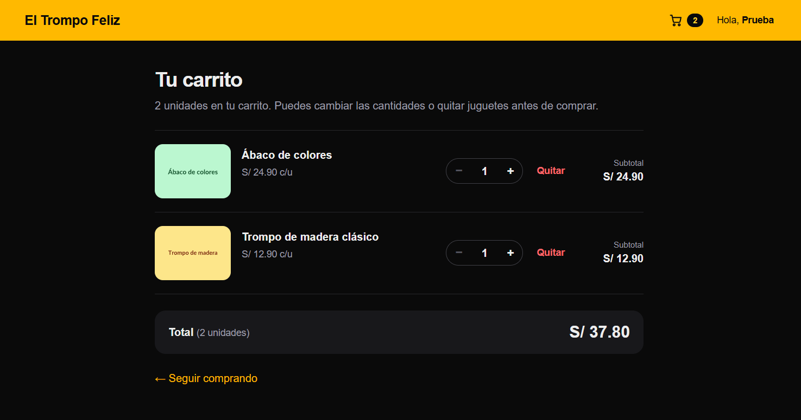
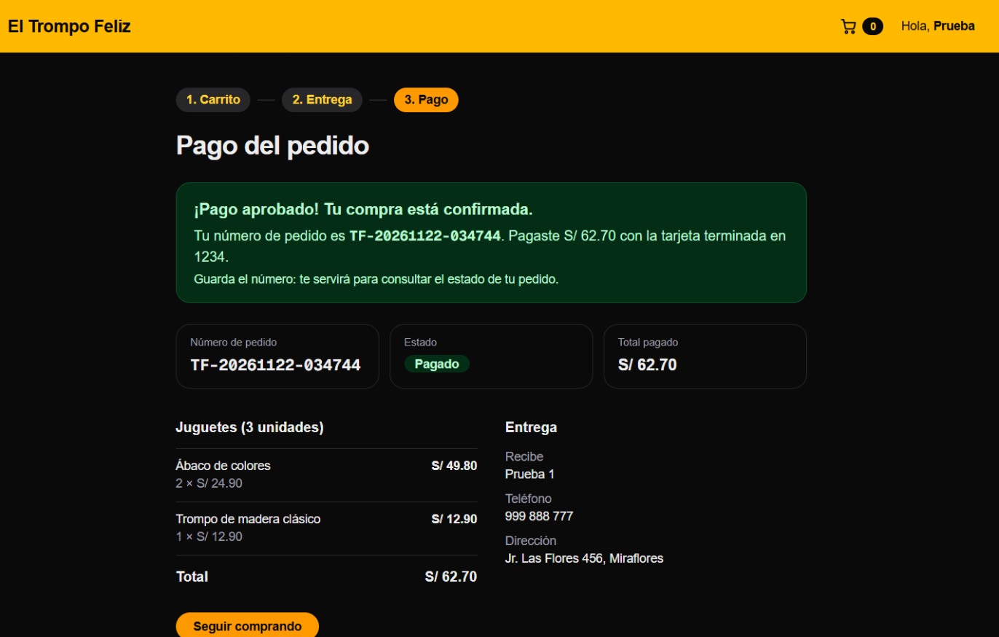
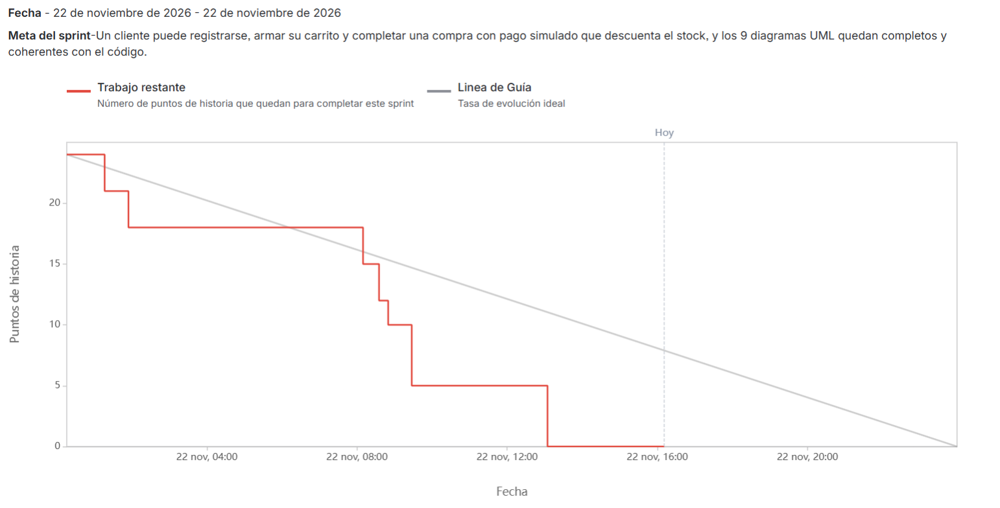
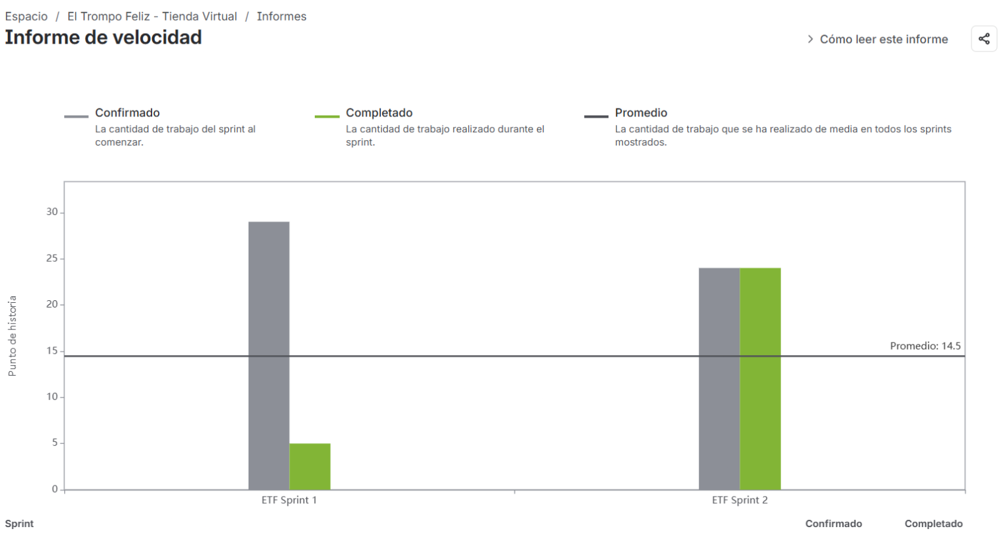
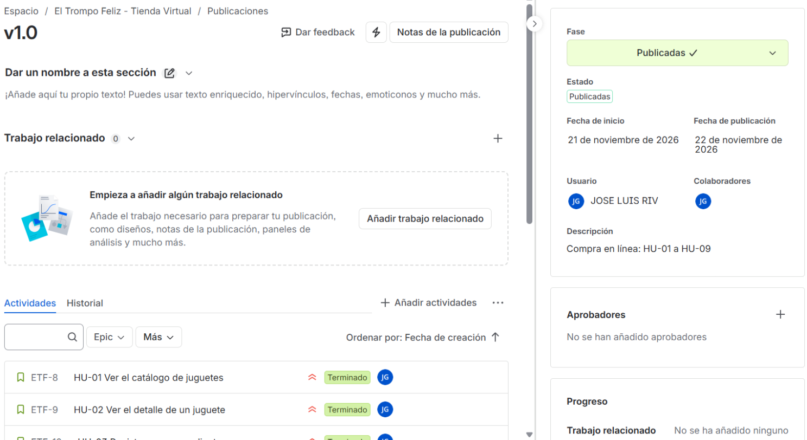
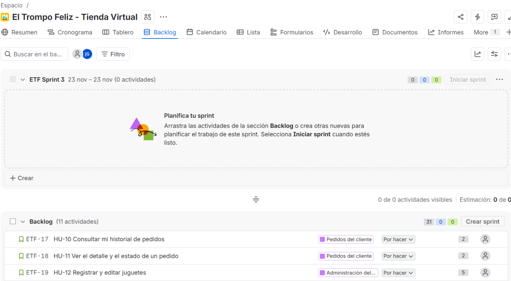

# Sprint Review: Sprint 2

**Producto:** Tienda virtual de juguetes «El Trompo Feliz»  
**Sprint:** ETF Sprint 2 (Jira, espacio `ETF`)  
**Fecha del sprint:** 22/11/2026. Se inició en Jira a las 00:16 y termina a las 23:59.  
**Fecha de la Review:** 22/11/2026 por la tarde, con las 7 historias y T-06 y T-07 terminadas, antes de cerrar el sprint en Jira.  
**Equipo Scrum:** José Luis Rivera Gonzales (Product Owner, Scrum Master y Developer)  
**Partes interesadas:** el docente del curso, que tiene acceso al tablero de Jira, al repositorio y a la tienda publicada.

El plan del sprint está en el [Sprint 2 Planning](sprint-2-planning.md) y la Retrospectiva, en [`sprint-2-retrospectiva.md`](sprint-2-retrospectiva.md).

---

## 1. Meta del sprint y resultado

> «Un cliente puede registrarse, armar su carrito y completar una compra con pago simulado que descuenta el stock, y los 9 diagramas UML quedan completos y coherentes con el código».

**Resultado: la meta se cumplió.** En la tienda publicada, un cliente puede:
- crear su cuenta e iniciar sesión;
- agregar juguetes al carrito y ajustar las cantidades;
- generar su pedido con los datos de entrega;
- pagarlo con una tarjeta simulada.

El pago aprobado descuenta el stock en la misma transacción. Los 9 diagramas UML están completos en [`docs/uml`](../uml/README.md), con los mismos nombres de clases y métodos que el código.

Con este sprint queda terminada la **release v1.0 (Compra en línea)**: HU-01 a HU-09, 29 puntos.

## 2. Lo comprometido y lo terminado

En el Sprint Planning se comprometieron 7 historias (24 puntos) y 3 tareas técnicas, estimadas en 10,5 horas.

| Orden | Clave | ID | Actividad | Puntos | Horas estimadas | PR | Estado al cierre |
|---|---|---|---|---|---|---|---|
| 1 | ETF-10 | HU-03 | Registrarme como cliente | 3 | 1 | [#13](https://github.com/joseriverago/el-trompo-feliz/pull/13) | Terminado |
| 2 | ETF-11 | HU-04 | Iniciar sesión | 3 | 0,75 | [#14](https://github.com/joseriverago/el-trompo-feliz/pull/14) | Terminado |
| 3 | ETF-12 | HU-05 | Agregar un juguete al carrito | 3 | 1 | [#15](https://github.com/joseriverago/el-trompo-feliz/pull/15) | Terminado |
| 4 | ETF-13 | HU-06 | Cambiar cantidades y quitar juguetes del carrito | 3 | 0,75 | [#16](https://github.com/joseriverago/el-trompo-feliz/pull/16) | Terminado |
| 5 | ETF-14 | HU-07 | Ver subtotales y total del carrito | 2 | 0,5 | [#17](https://github.com/joseriverago/el-trompo-feliz/pull/17) | Terminado |
| 6 | ETF-15 | HU-08 | Ingresar los datos de entrega y generar el pedido | 5 | 1,25 | [#18](https://github.com/joseriverago/el-trompo-feliz/pull/18) | Terminado |
| 7 | ETF-16 | HU-09 | Pagar el pedido con pago simulado | 5 | 1,25 | [#19](https://github.com/joseriverago/el-trompo-feliz/pull/19) | Terminado |
| — | ETF-33 | T-06 | Elaborar los diagramas de secuencia | — | 1,5 | [#20](https://github.com/joseriverago/el-trompo-feliz/pull/20) | Terminado |
| — | ETF-34 | T-07 | Elaborar los modelos de implementación y de despliegue | — | 1,5 | [#21](https://github.com/joseriverago/el-trompo-feliz/pull/21) | Terminado |
| — | ETF-35 | T-08 | Completar el README y las evidencias de los sprints | — | 1 | [#22](https://github.com/joseriverago/el-trompo-feliz/pull/22) | Terminado |

**Resumen:** 10 de 10 actividades: las 7 historias (24 puntos) y las 3 tareas. No pasa nada al siguiente sprint.

T-06 se repartió entre las historias, como acordó la retrospectiva:
- el diagrama de CU-07 (06a) llegó con HU-05;
- el de CU-09 llegó con HU-08 (06b) y HU-09 (06c);
- el PR #20 agregó el de CU-12 (06d y 06e).

## 3. Incremento

| Parte | Dirección pública |
|---|---|
| Tienda (frontend Next.js en Vercel) | https://el-trompo-feliz-jrivera.vercel.app |
| API (backend NestJS en Render) | https://el-trompo-feliz-api.onrender.com |

**Lo nuevo en la tienda:**

- **Registro e inicio de sesión** (`/registro`, `/iniciar-sesion`). El encabezado saluda con «Hola, {nombre}» y la sesión se mantiene al recargar.
- **Agregar al carrito** desde el catálogo o el detalle, con un contador en el encabezado. No deja superar el stock («Solo quedan N unidades»). Sin sesión, lleva a iniciar sesión y después vuelve al juguete.
- **Carrito** (`/carrito`):
  - cambiar cantidades entre 1 y el stock disponible, o quitar juguetes;
  - ver el subtotal de cada línea y el total;
  - si queda vacío, muestra «Tu carrito está vacío».
  - El carrito se guarda en la base de datos.
- **Comprar** (`/comprar`): formulario de entrega junto al resumen del carrito. El pedido se genera en estado Pendiente con un número único `TF-AAAAMMDD-NNNNNN`, el precio vigente de cada juguete y el carrito vaciado.
- **Pagar** (`/pedidos/{numero}/pago`): tarjeta simulada.
  - Una tarjeta aprobada pasa el pedido a Pagado y descuenta el stock.
  - Una tarjeta que termina en 0000 muestra «Pago rechazado» y permite reintentar.
- Las páginas nuevas se adaptan al ancho de un celular.

**Rutas de la API:**
- Del Sprint 1: `GET /`, `GET /salud`, `GET /juguetes`, `GET /juguetes/:id`.
- Nuevas en este sprint: `POST /auth/registro`, `POST /auth/inicio-sesion`, `GET /carrito`, `POST /carrito/items`, `PATCH /carrito/items/:itemId`, `DELETE /carrito/items/:itemId`, `POST /pedidos`, `GET /pedidos/:numero` y `POST /pedidos/:numero/pago`.
- Las rutas del carrito, los pedidos y el pago exigen el token JWT (`JwtAuthGuard`).

**Modelos UML:** el sprint agregó los diagramas de secuencia (06a a 06e), componentes y artefactos (07a y 07b), y despliegue descriptor (08) e instancia (09). Con los 5 modelos del Sprint 1 se completan los 9 que pide la actividad.

Cada actividad se desarrolló en su propia rama y se integró a `main` con un pull request. Vercel y Render publicaron cada integración de forma automática.

| PR | Clave | Contenido | Integrado |
|---|---|---|---|
| [#12](https://github.com/joseriverago/el-trompo-feliz/pull/12) | ETF-35 | Acta del Sprint 2 Planning | 00:22 |
| [#13](https://github.com/joseriverago/el-trompo-feliz/pull/13) | ETF-10 | Registro de clientes | 00:47 |
| [#14](https://github.com/joseriverago/el-trompo-feliz/pull/14) | ETF-11 | Inicio de sesión | 01:30 |
| [#15](https://github.com/joseriverago/el-trompo-feliz/pull/15) | ETF-12 | Agregar al carrito y secuencia de CU-07 (06a) | 08:06 |
| [#16](https://github.com/joseriverago/el-trompo-feliz/pull/16) | ETF-13 | Cambiar cantidades y quitar juguetes | 08:31 |
| [#17](https://github.com/joseriverago/el-trompo-feliz/pull/17) | ETF-14 | Subtotales y total del carrito | 08:46 |
| [#18](https://github.com/joseriverago/el-trompo-feliz/pull/18) | ETF-15 | Datos de entrega, pedido y secuencia de CU-09 (06b) | 09:15 |
| [#19](https://github.com/joseriverago/el-trompo-feliz/pull/19) | ETF-16 | Pago simulado y secuencia del pago (06c) | 12:56 |
| [#20](https://github.com/joseriverago/el-trompo-feliz/pull/20) | ETF-33 | Secuencia de CU-12 Gestionar productos (06d y 06e) | 13:14 |
| [#21](https://github.com/joseriverago/el-trompo-feliz/pull/21) | ETF-34 | Componentes, artefactos y despliegue (07a, 07b, 08 y 09) | 13:39 |
| [#22](https://github.com/joseriverago/el-trompo-feliz/pull/22) | ETF-35 | README final, esta Review, la Retrospectiva y las evidencias pendientes | 16:25 |

  
  

## 4. Demostración contra los criterios de aceptación

El Product Owner revisó cada criterio:
- primero en local;
- después en la tienda publicada, con una cuenta de cliente de prueba.

Hay dos casos que solo se probaron en local:
- **Stock insuficiente al comprar (HU-08).** Para provocarlo, se bajó por un momento el stock de un juguete en Neon y se restauró en seguida.
- **Otro cliente se lleva las últimas unidades antes del pago (HU-09).** Repetir esa carrera en producción habría afectado el stock real.

### HU-03 · Registrarme como cliente (ETF-10): aceptada

| Criterio | Resultado | Evidencia |
|---|---|---|
| 1. Con nombre, correo válido y contraseña de 8 o más caracteres se crea la cuenta y queda la sesión iniciada. | Cumple | [h03-05](../evidencias/sprint-2/h03-05-formulario-completo.png), [h03-06](../evidencias/sprint-2/h03-06-registro-exitoso-hola-begona.png), en producción [h03-14](../evidencias/sprint-2/h03-14-publico-registro-exitoso.png) |
| 2. Con un correo ya registrado se ve «Este correo ya está registrado» y no se crea otra cuenta. | Cumple | [h03-08](../evidencias/sprint-2/h03-08-correo-duplicado.png) |
| 3. Con campos vacíos o un correo inválido se ve qué campo corregir. | Cumple | [h03-03](../evidencias/sprint-2/h03-03-campos-obligatorios.png), [h03-04](../evidencias/sprint-2/h03-04-correo-y-contrasena-invalidos.png) |
| 4. La contraseña se guarda cifrada con bcrypt, nunca en texto plano. | Cumple | Consulta a Neon del 22/11: los 5 usuarios tienen un hash `$2b$10$…` de 60 caracteres (bcrypt, costo 10). Lo cubren también las pruebas de `AuthService`. |

**Observación:** el primer despliegue en Render falló porque faltaba la variable `JWT_SECRET` ([h03-12](../evidencias/sprint-2/h03-12-render-falta-jwt-secret.png)). La API no arranca sin ella, a propósito. Se agregó en el panel de Render y el servicio quedó en línea ([h03-13](../evidencias/sprint-2/h03-13-render-despliegue-en-linea.png)).

### HU-04 · Iniciar sesión (ETF-11): aceptada

| Criterio | Resultado | Evidencia |
|---|---|---|
| 1. Con correo y contraseña correctos se ve el nombre en la barra y se puede usar el carrito. | Cumple | [h04-06](../evidencias/sprint-2/h04-06-formulario-completo.png), [h04-07](../evidencias/sprint-2/h04-07-sesion-iniciada-hola-rosa.png), en producción [h04-17](../evidencias/sprint-2/h04-17-produccion-sesion-iniciada-catalogo.png) |
| 2. Con datos incorrectos se ve el mensaje genérico «Correo o contraseña incorrectos». | Cumple | [h04-04](../evidencias/sprint-2/h04-04-contrasena-incorrecta.png) (contraseña errónea) y [h04-05](../evidencias/sprint-2/h04-05-correo-sin-cuenta.png) (correo sin cuenta) muestran el mismo mensaje |
| 3. La sesión se mantiene al recargar o navegar. | Cumple | [h04-08](../evidencias/sprint-2/h04-08-recarga-sesion-se-mantiene.png) |

**Observación:** todavía no hay botón para cerrar sesión: es HU-18, de la release v2.0. El token vence a los 7 días, y la tienda ignora una sesión vencida.

### HU-05 · Agregar un juguete al carrito (ETF-12): aceptada

| Criterio | Resultado | Evidencia |
|---|---|---|
| 1. Con sesión y stock, «Agregar al carrito» lo agrega con cantidad 1 y el contador aumenta. | Cumple | [h05-05](../evidencias/sprint-2/h05-05-agregado-cantidad-1.png), [h05-08](../evidencias/sprint-2/h05-08-catalogo-agregado-contador-4.png), en producción [h05-13](../evidencias/sprint-2/h05-13-produccion-agregado-cantidad-1.png) |
| 2. Agregarlo otra vez aumenta la cantidad sin duplicar la línea. | Cumple | [h05-06](../evidencias/sprint-2/h05-06-agregado-otra-vez-cantidad-2.png) |
| 3. Con la cantidad igual al stock se ve «Solo quedan N unidades» y la cantidad no cambia. | Cumple | [h05-07](../evidencias/sprint-2/h05-07-tope-de-stock-solo-quedan-3.png), en producción [h05-14](../evidencias/sprint-2/h05-14-produccion-tope-de-stock.png) |
| 4. Sin sesión, lleva a la página de inicio de sesión. | Cumple | [h05-02](../evidencias/sprint-2/h05-02-detalle-sin-sesion.png), [h05-03](../evidencias/sprint-2/h05-03-sin-sesion-lleva-a-iniciar-sesion.png); después de iniciar sesión vuelve al juguete: [h05-04](../evidencias/sprint-2/h05-04-vuelve-al-juguete-con-sesion.png) |

### HU-06 · Cambiar cantidades y quitar juguetes del carrito (ETF-13): aceptada

| Criterio | Resultado | Evidencia |
|---|---|---|
| 1. La nueva cantidad se guarda y no puede ser menor que 1 ni mayor que el stock. | Cumple | [h06-02](../evidencias/sprint-2/h06-02-carrito-limites-de-cantidad.png), [h06-03](../evidencias/sprint-2/h06-03-aumentar-cantidad-abaco-2.png), [h06-04](../evidencias/sprint-2/h06-04-disminuir-yoyo-guardado-al-recargar.png), en producción [h06-13](../evidencias/sprint-2/h06-13-produccion-carrito-tope-de-stock.png) y [h06-14](../evidencias/sprint-2/h06-14-produccion-cantidad-1-guardada.png) |
| 2. «Quitar» saca el juguete del carrito. | Cumple | [h06-05](../evidencias/sprint-2/h06-05-quitar-abaco.png) |
| 3. Con el carrito vacío se ve «Tu carrito está vacío» y un enlace al catálogo. | Cumple | [h06-06](../evidencias/sprint-2/h06-06-carrito-vacio.png), en producción [h06-15](../evidencias/sprint-2/h06-15-produccion-carrito-vacio.png) |

### HU-07 · Ver subtotales y total del carrito (ETF-14): aceptada

| Criterio | Resultado | Evidencia |
|---|---|---|
| 1. Cada línea muestra precio unitario, cantidad y subtotal, y al final el total. | Cumple | [h07-02](../evidencias/sprint-2/h07-02-subtotales-y-total.png), en producción [h07-09](../evidencias/sprint-2/h07-09-produccion-subtotales-y-total.png) |
| 2. Al cambiar una cantidad o quitar un juguete, se recalculan de inmediato. | Cumple | [h07-03](../evidencias/sprint-2/h07-03-cambiar-cantidad-recalcula.png), [h07-04](../evidencias/sprint-2/h07-04-quitar-juguete-recalcula.png), en producción [h07-10](../evidencias/sprint-2/h07-10-produccion-recalcula-total.png) |
| 3. Al volver a entrar con la cuenta, el carrito tiene los mismos juguetes y cantidades. | Cumple | [h07-05](../evidencias/sprint-2/h07-05-mismo-carrito-al-volver-a-entrar.png) |

### HU-08 · Ingresar los datos de entrega y generar el pedido (ETF-15): aceptada

| Criterio | Resultado | Evidencia |
|---|---|---|
| 1. «Comprar» muestra el formulario de entrega junto al resumen del carrito y el total. | Cumple | [h08-02](../evidencias/sprint-2/h08-02-local-carrito-boton-comprar.png), [h08-03](../evidencias/sprint-2/h08-03-local-formulario-entrega-resumen.png), en producción [h08-14](../evidencias/sprint-2/h08-14-produccion-carrito-boton-comprar.png) y [h08-15](../evidencias/sprint-2/h08-15-produccion-formulario-entrega.png) |
| 2. Si falta un dato o el teléfono no tiene 9 dígitos, se ve qué corregir y no se genera el pedido. | Cumple | [h08-04](../evidencias/sprint-2/h08-04-local-campos-a-corregir.png), en producción [h08-16](../evidencias/sprint-2/h08-16-produccion-campos-a-corregir.png) |
| 3. Con datos válidos y stock suficiente se genera el pedido Pendiente con número único y precio vigente, se vacía el carrito y se pasa al pago. | Cumple | [h08-06](../evidencias/sprint-2/h08-06-local-pedido-generado-pago.png), [h08-07](../evidencias/sprint-2/h08-07-local-carrito-vacio-tras-pedido.png), en producción [h08-17](../evidencias/sprint-2/h08-17-produccion-pedido-generado-pago.png) y [h08-18](../evidencias/sprint-2/h08-18-produccion-carrito-vacio.png) |
| 4. Si algún juguete supera su stock, se ve cuál ajustar y no se genera el pedido. | Cumple (en local) | [h08-05](../evidencias/sprint-2/h08-05-local-juguete-sin-stock.png) |

### HU-09 · Pagar el pedido con pago simulado (ETF-16): aceptada

| Criterio | Resultado | Evidencia |
|---|---|---|
| 1. Con una tarjeta válida que no termina en 0000, el pedido pasa a Pagado, se descuenta el stock y se ve la confirmación. | Cumple | [h09-02](../evidencias/sprint-2/h09-02-local-formulario-pago.png), [h09-03](../evidencias/sprint-2/h09-03-local-tarjeta-a-corregir.png) (datos a corregir), [h09-06](../evidencias/sprint-2/h09-06-local-pago-aprobado.png), en producción [h09-13](../evidencias/sprint-2/h09-13-produccion-formulario-pago.png) y [h09-15](../evidencias/sprint-2/h09-15-produccion-pago-aprobado.png) |
| 2. Con una tarjeta que termina en 0000 se ve «Pago rechazado», el pedido sigue Pendiente y se puede reintentar. | Cumple | [h09-04](../evidencias/sprint-2/h09-04-local-pago-rechazado.png), en producción [h09-14](../evidencias/sprint-2/h09-14-produccion-pago-rechazado.png) |
| 3. Si otro cliente se llevó las últimas unidades, se ve qué juguete falta y no se descuenta nada (una sola transacción). | Cumple (en local) | [h09-05](../evidencias/sprint-2/h09-05-local-sin-stock-al-pagar.png) |
| 4. Un pedido ya Pagado no se vuelve a pagar ni a descontar. | Cumple | [h09-07](../evidencias/sprint-2/h09-07-local-pedido-ya-pagado.png), en producción [h09-16](../evidencias/sprint-2/h09-16-produccion-pedido-ya-pagado.png) |
| 5. Solo se guardan los últimos 4 dígitos de la tarjeta y el resultado, nunca el número completo ni el CVV. | Cumple | Consulta a Neon del 22/11: la tabla `pagos` tiene `id`, `pedido_id`, `monto`, `ultimos_digitos`, `aprobado` y `creado_en`; los 5 pagos guardan 4 dígitos y no hay columna para el CVV. |

**Protecciones en la base de datos:** un índice único parcial impide dos pagos aprobados para el mismo pedido, y `CHECK (stock >= 0)` impide un stock negativo aunque fallara la validación de la API.

## 5. Revisión de la Definición de Terminado

Se revisó la [Definición de Terminado](definicion-de-listo-y-terminado.md#definición-de-terminado-definition-of-done) de cada historia antes de moverla a Terminado:

| Punto de la DoD | HU-03 | HU-04 | HU-05 | HU-06 | HU-07 | HU-08 | HU-09 |
|---|---|---|---|---|---|---|---|
| Cumple todos sus criterios de aceptación | Sí | Sí | Sí | Sí | Sí | Sí | Sí |
| Valida en el navegador y en el servidor | Sí | Sí | Sí | Sí | No recibe datos nuevos | Sí | Sí |
| Los datos vienen de PostgreSQL (Neon) | Sí | Sí | Sí | Sí | Sí | Sí | Sí |
| TypeScript y `npm run build` sin errores | Sí | Sí | Sí | Sí | Sí | Sí | Sí |
| Rama propia y pull request | #13 | #14 | #15 | #16 | #17 | #18 | #19 |
| Commits con la clave de Jira | Sí | Sí | Sí | Sí | Sí | **No** (ver nota) | Sí |
| Sin contraseñas ni cadenas de conexión en el repositorio | Sí | Sí | Sí | Sí | Sí | Sí | Sí |
| Desplegado y verificado en la URL pública | Sí | Sí | Sí | Sí | Sí | Sí | Sí |
| Diagramas UML coherentes con el código | 04b, 05b | 04b, 05b | 06a | 04c | 04c | 06b | 06c |
| En la columna Terminado de Jira | Sí | Sí | Sí | Sí | Sí | Sí | Sí |

**Nota sobre HU-08.** Sus 4 commits (`5d1d41d`, `a9068b8`, `80f4961` y `f6a1877`) citan «HU-08», pero no la clave `ETF-15`. La rama `feature/ETF-15-generar-pedido` y el título del PR #18 sí la tienen, así que Jira enlaza igual el trabajo con la incidencia. No se reescribió la historia de `main`. Desde HU-09, cada commit lleva `Refs ETF-…` en el cuerpo. La Retrospectiva recoge la acción.

El backend tiene **147 pruebas automatizadas** (Vitest) en 18 archivos, y todas pasan; al cierre del Sprint 1 eran 20. Cubren el registro y el inicio de sesión, `JwtAuthGuard`, el carrito, la generación del pedido, el pago y los DTO de validación. Usan datos en español: «Begoña Ñahui Ávila», correos en mayúsculas y direcciones de Lima.

## 6. Burndown y velocidad

| Hora aproximada | Trabajo restante | Qué pasó |
|---|---|---|
| 00:16 | 24 puntos | Inicio del sprint |
| Cerca de la 01:15 | 21 | Terminó HU-03 (3 puntos) |
| Cerca de las 01:55 | 18 | Terminó HU-04 (3 puntos) |
| De las 02:00 a las 08:00 | 18 | La línea queda plana: es la pausa de la noche |
| Cerca de las 08:10 | 15 | Terminó HU-05 (3 puntos) |
| Cerca de las 08:35 | 12 | Terminó HU-06 (3 puntos) |
| Cerca de las 08:50 | 10 | Terminó HU-07 (2 puntos) |
| Cerca de las 09:30 | 5 | Terminó HU-08 (5 puntos) |
| Cerca de las 13:10 | **0** | Terminó HU-09 (5 puntos) |

- La línea roja va por debajo de la línea guía todo el sprint, salvo entre las 06:15 y las 08:10, al final de la pausa de la noche. Desde las 08:10 ya no vuelve a cruzarla.
- T-06, T-07 y T-08 no llevan puntos, así que su avance, después de las 13:10, no se ve en el gráfico.
- **Velocidad real del Sprint 2: 24 puntos**, todo lo comprometido. La del Sprint 1 fue de 5 puntos. Las 10,5 horas estimadas en el Planning alcanzaron para las 10 actividades.
- **HU-09 fue la más larga.** Entre la integración de HU-08 (09:15) y la de HU-09 (12:56) pasaron 3 h 41 min, frente a 1,25 h estimadas. Es la historia con más reglas: transacción, rechazo de prueba, carrera por el stock, índice único parcial y restricción `CHECK`. Además actualizó 5 diagramas.

El informe de velocidad de Jira, generado al cerrar el sprint, compara los dos sprints: 29 puntos comprometidos y 5 terminados en el Sprint 1, y 24 comprometidos y 24 terminados en el Sprint 2. El promedio es de 14,5 puntos.

## 7. Cambios en el Product Backlog

- **Release v1.0 (Compra en línea):** terminada, con HU-01 a HU-09 (29 puntos). Se publicó en Jira al cerrar el sprint (ver la sección 9).
- **Release v2.0 (Seguimiento y administración):** HU-10 a HU-20 (31 puntos) siguen en el Product Backlog, en el mismo orden. Su fecha en Jira se fija si el docente amplía el plazo y se planifica un Sprint 3.
- **Si hay un Sprint 3:**
  - las 6 historias de prioridad Alta (HU-10 a HU-15) suman 18 puntos y caben en la velocidad del Sprint 2;
  - las 5 de prioridad Media (13 puntos) entrarían por orden si queda capacidad.
  - Los diagramas de secuencia de CU-12 (06d y 06e) ya dejan diseñadas HU-12 y HU-20.
- La sección 11 del [Product Backlog](product-backlog.md#11-plan-de-entregas) se actualizó con la velocidad del Sprint 2 y el estado de las releases.

## 8. Riesgos y pendientes

| Riesgo o pendiente | Qué se hará |
|---|---|
| La base de datos de Neon es la misma para local y producción. Los clientes de prueba locales y los pedidos de prueba están en la base real. | La Retrospectiva propone una rama de Neon para desarrollo antes de seguir con v2.0. |
| El plan gratuito de Render duerme la API tras 15 minutos sin visitas. | La tienda muestra un aviso mientras despierta. Antes de cada demostración se abre `/salud`. |
| No hay botón para cerrar sesión, ni historial de pedidos para el cliente. | Son HU-18, HU-10 y HU-11, de la release v2.0. |
| El frontend no tiene pruebas automatizadas: se verificó a mano, con capturas en local y en producción. | Acción de la Retrospectiva para v2.0, que agrega formularios de administración. |

## 9. Cierre en Jira

Después de la Review y la Retrospectiva, el 22/11/2026:

1. **T-08 (ETF-35) pasó a Terminado** con un comentario que resume el PR #22 ([t08-07](../evidencias/sprint-2/t08-07-jira-etf35-terminado.png)). El tablero quedó con las 10 actividades en Terminado ([t08-08](../evidencias/sprint-2/t08-08-jira-tablero-diez-terminadas.png)).
2. **Se publicó la release v1.0** con fecha 22/11/2026. Incluye 14 incidencias, todas terminadas: HU-01 a HU-09 y las tareas T-01 a T-05 ([s2-11](../evidencias/sprint-2/s2-11-jira-publicar-v1-0.png), [s2-12](../evidencias/sprint-2/s2-12-jira-v1-0-publicada.png)).
3. **Se completó el ETF Sprint 2** cerca de las 16:30, con sus 10 actividades terminadas ([s2-13](../evidencias/sprint-2/s2-13-jira-sprint-2-todo-terminado.png), [s2-14](../evidencias/sprint-2/s2-14-jira-completar-sprint-2.png)). No se creó la retrospectiva de Confluence que ofrece Jira, porque la Retrospectiva está en el repositorio.
4. **Jira creó un ETF Sprint 3 vacío y sin iniciar.** HU-10 a HU-20 (31 puntos) quedan en el Product Backlog hasta que se planifique ese sprint ([s2-15](../evidencias/sprint-2/s2-15-jira-sprint-2-completado.png)).

  
  

