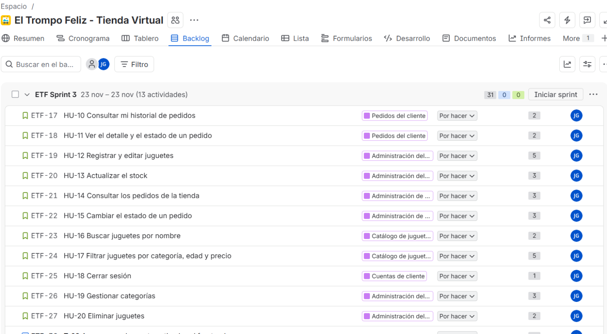
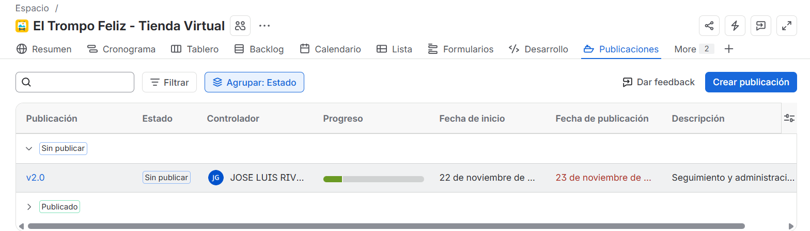

# Sprint Planning: Sprint 3

**Producto:** Tienda virtual de juguetes «El Trompo Feliz»  
**Sprint:** ETF Sprint 3 (Jira, espacio `ETF`)  
**Fecha:** 22/11/2026. El sprint se inició en Jira a las 18:31 y termina el 23/11/2026 a las 23:59, sin cierre automático.  
**Equipo Scrum:** José Luis Rivera Gonzales (Product Owner, Scrum Master y Developer)

Este Sprint Planning aplica las acciones de la [Retrospectiva del Sprint 2](sprint-2-retrospectiva.md#3-acciones-para-un-sprint-3) y parte de los resultados de la [Sprint Review del Sprint 2](sprint-2-review.md).

---

## 1. Meta del sprint

> «El cliente sigue sus pedidos y cierra sesión, el visitante busca y filtra el catálogo, y el administrador gestiona juguetes, stock, categorías y pedidos; la release v2.0 queda publicada».

La meta completa la release **v2.0 (Seguimiento y administración)**, la última del Product Backlog. Al cerrar este sprint no quedan historias pendientes.

## 2. Capacidad

- **Capacidad declarada por el Developer:** unas 14 horas, entre la noche del 22/11 y el 23/11/2026.
- **Velocidad del Sprint 2:** 24 puntos, en unas 10,5 horas de trabajo estimado. Ese sprint incluyó 4 horas de tareas técnicas (T-06 a T-08).
- **Dato usado para estimar:** según la [Retrospectiva](sprint-2-retrospectiva.md#2-qué-se-puede-mejorar), HU-09 tomó 3 h 41 min frente a 1,25 h estimadas, por su transacción y sus reglas de concurrencia. Las historias de pantalla (HU-03 a HU-07) tomaron lo estimado o menos.

El compromiso (31 puntos) supera la velocidad del Sprint 2 (24 puntos), por tres razones:

1. Las tareas técnicas pesan menos: T-09 y T-10 suman 3 horas, frente a las 4 horas de T-06 a T-08.
2. La v2.0 reutiliza lo que ya existe: la sesión, los pedidos y el esquema de la base de datos. El esquema no cambia, porque las tablas ya tienen el rol del usuario, el estado del pedido, las categorías y el campo `activo` de los juguetes.
3. Las historias de la v2.0 son sobre todo de pantalla y de consulta. Solo HU-13 (stock) y HU-15 (estado del pedido) tienen reglas de concurrencia, y se estimaron con más holgura.

Si el tiempo no alcanza, las historias de prioridad Media (HU-16 a HU-20), que van al final, vuelven al Product Backlog.

## 3. Sprint Backlog

| Orden | Clave | ID | Actividad | Puntos | Horas estimadas |
|---|---|---|---|---|---|
| 1 | ETF-17 | HU-10 | Consultar mi historial de pedidos | 2 | 0,75 |
| 2 | ETF-18 | HU-11 | Ver el detalle y el estado de un pedido | 2 | 0,75 |
| 3 | ETF-36 | T-09 | Agregar pruebas automatizadas al frontend | — | 1,5 |
| 4 | ETF-19 | HU-12 | Registrar y editar juguetes | 5 | 2 |
| 5 | ETF-20 | HU-13 | Actualizar el stock | 3 | 1 |
| 6 | ETF-21 | HU-14 | Consultar los pedidos de la tienda | 3 | 1 |
| 7 | ETF-22 | HU-15 | Cambiar el estado de un pedido | 3 | 1 |
| 8 | ETF-23 | HU-16 | Buscar juguetes por nombre | 2 | 0,5 |
| 9 | ETF-24 | HU-17 | Filtrar juguetes por categoría, edad y precio | 5 | 1,5 |
| 10 | ETF-25 | HU-18 | Cerrar sesión | 1 | 0,25 |
| 11 | ETF-26 | HU-19 | Gestionar categorías | 3 | 1,25 |
| 12 | ETF-27 | HU-20 | Eliminar juguetes | 2 | 0,5 |
| 13 | ETF-37 | T-10 | Actualizar los diagramas, el README y las evidencias del Sprint 3 | — | 1,5 |
| | | | **Total** | **31** | **13,5** |

Las 13,5 horas estimadas caben en la capacidad declarada. Las 11 historias cumplen la [Definición de Listo](definicion-de-listo-y-terminado.md#definición-de-listo-definition-of-ready): están refinadas, estimadas y con criterios de aceptación desde el Sprint 1, y sus casos de uso están en los diagramas UML. T-09 y T-10 se crearon en este Planning, a partir de las acciones 4 y 6 de la Retrospectiva del Sprint 2.

Las historias conservan la etiqueta `sprint-2` de la importación inicial a Jira, cuando se planeaba hacerlas en el Sprint 2. Se mantiene como registro del plan original; el sprint real es el que muestra Jira.

## 4. Cómo se hará el trabajo

1. **Pedidos del cliente (HU-10 y HU-11).** Van primero porque reutilizan la sesión y los pedidos de la v1.0. Se agregan `GET /pedidos` (`PedidosController.listarMios`) y las páginas «Mis pedidos» y el detalle del pedido, que ofrece «Pagar ahora» si el pedido sigue Pendiente.
2. **Pruebas del frontend (T-09).** Vitest y Testing Library prueban las validaciones de los formularios de registro, entrega y pago. Van antes de los formularios de administración, para que esos formularios ya nazcan con pruebas.
3. **Administración del catálogo (HU-12 y HU-13).** Se construye `RolesGuard` con el decorador `@Roles`, que se aplica después de `JwtAuthGuard` y responde 403 a quien no es administrador. Después se agregan `POST /juguetes`, `PUT /juguetes/:id` y `PATCH /juguetes/:id/stock`, y las páginas `/admin/juguetes` y `/admin/inventario`, según el diagrama de secuencia 06d.
4. **Administración de pedidos (HU-14 y HU-15).** Se agregan las rutas `/admin/pedidos` y las páginas del administrador. El estado solo avanza de Pagado a Enviado y de Enviado a Entregado. Un pedido pasa a Pagado solo con el pago, y Entregado es el estado final.
5. **Catálogo (HU-16 y HU-17).** `GET /juguetes` acepta `nombre`, `categoriaId`, `edad`, `precioMin` y `precioMax`. La búsqueda por nombre no distingue mayúsculas ni tildes.
6. **Cuentas, categorías y eliminación (HU-18 a HU-20).** Se agregan el botón «Cerrar sesión», la gestión de categorías (`/categorias` y `/admin/categorias`) y la eliminación lógica de juguetes (`DELETE /juguetes/:id`), según el diagrama 06e.
7. **Cierre (T-10).** Primero se escriben las reglas de PlantUML. Después se actualizan los diagramas de diseño, subsistemas y componentes con lo construido, junto con el README y el Product Backlog. Al final, la Sprint Review, la Retrospectiva y la publicación de la release v2.0 en Jira.

Cada historia sigue el flujo de los sprints anteriores:

- rama `feature/ETF-<número>-…`;
- commits con la clave de Jira;
- pull request y despliegue automático;
- pruebas automatizadas en el backend, con datos en español;
- prueba de los criterios en local y en la URL pública;
- paso a Terminado en Jira, con un comentario que enlaza el PR.

Los nombres de las clases y los métodos son los de los [diagramas UML](../uml/README.md).

## 5. Acciones de la retrospectiva aplicadas

| Acción del Sprint 2 | Cómo se aplica en este planning |
|---|---|
| 1. Separar la base de datos de desarrollo | Se creó en Neon la rama `desarrollo` a partir de `production`, sin borrado automático ([s3-04](../evidencias/sprint-3/s3-04-neon-rama-desarrollo.png)). El `backend/.env` local apunta a ella y `npm run db:preparar` la dejó lista. Las pruebas locales ya no tocan la base de producción, que queda solo para las pruebas en la URL pública. |
| 2. Versionar las capturas a medida que se toman | Las capturas locales de cada historia van en su PR. Las de producción y de Jira van en un commit `docs(evidencias)` con la clave de esa historia, en la rama de la actividad siguiente. Así quedan versionadas en el PR siguiente, sin abrir un PR más por historia. |
| 3. Revisar la clave de Jira antes de abrir cada PR | Antes de cada PR se revisa `git log main..HEAD`. |
| 4. Agregar pruebas al frontend | T-09 está en el orden 3, antes de los formularios de administración (HU-12). |
| 5. Estimar con los datos reales | Cada actividad tiene horas estimadas. HU-12 tiene 2 horas, la mayor estimación del sprint: lleva el control de roles y el formulario más largo. La Sprint Review comparará estas horas con las reales, según Jira. |
| 6. Escribir las reglas de PlantUML | Es el primer paso de T-10, antes de actualizar los diagramas. |

## 6. Lo que queda fuera del sprint

- **Nada del Product Backlog:** entran las 11 historias que quedaban (HU-10 a HU-20).
- **Release v2.0:** su fecha de publicación en Jira pasó del 22/11 al **23/11/2026**, el fin del Sprint 3.

## 7. Evidencias del Sprint Planning

| Captura | Qué muestra |
|---|---|
| [s3-01a](../evidencias/sprint-3/s3-01a-jira-sprint-3-cargado-historias.png) | El Sprint 3 en el backlog, antes de iniciarlo, con las historias HU-10 a HU-20. |
| [s3-01b](../evidencias/sprint-3/s3-01b-jira-sprint-3-cargado-tareas.png) | El final de la lista: T-09, T-10 y el total de 13 actividades y 31 puntos. |
| [s3-02](../evidencias/sprint-3/s3-02-jira-iniciar-sprint-3.png) | El diálogo «Iniciar sprint» con las fechas y la meta. |
| [s3-03](../evidencias/sprint-3/s3-03-jira-tablero-sprint-3-iniciado.png) | El tablero con el Sprint 3 iniciado y las 13 actividades en Por hacer. |
| [s3-04](../evidencias/sprint-3/s3-04-neon-rama-desarrollo.png) | Las 2 ramas de Neon: `production` y la nueva `desarrollo`, sin fecha de vencimiento. |
| [s3-05](../evidencias/sprint-3/s3-05-jira-release-v2-0-al-23-nov.png) | La release v2.0 en Jira, con la nueva fecha de publicación. |
