# Diagramas UML

Fuentes en PlantUML (`.puml`) y sus imágenes en [`png/`](png/). Cada diagrama usa los mismos nombres que las historias de usuario, los casos de uso y el código.

| # | Diagrama | Modelo | Tarea | Archivos |
|---|---|---|---|---|
| 1 | Casos de uso | Requisitos | ETF-31 | [01-casos-de-uso](png/01-casos-de-uso.png) |
| 2 | Clases de análisis (boundary, control, entity) | Análisis | ETF-31 | [02a catálogo y cuentas](png/02a-clases-analisis-catalogo-cuentas.png) · [02b compra](png/02b-clases-analisis-compra.png) · [02c administración](png/02c-clases-analisis-administracion.png) |
| 3 | Paquetes | Análisis | ETF-31 | [03-paquetes](png/03-paquetes.png) |
| 4 | Clases de diseño | Diseño | ETF-32 | [04a dominio](png/04a-clases-diseno-dominio.png) · [04b catálogo y cuentas](png/04b-clases-diseno-catalogo-cuentas.png) · [04c compra](png/04c-clases-diseno-compra.png) |
| 5 | Subsistemas con interfaces | Diseño | ETF-32 | [05a interfaces](png/05a-subsistemas-interfaces.png) · [05b operaciones](png/05b-subsistemas-operaciones.png) |
| 6 | Secuencia: Agregar producto al carrito, Realizar compra y Gestionar productos | Diseño | ETF-33 | [06a agregar al carrito](png/06a-secuencia-agregar-carrito.png) · [06b realizar compra 1/2](png/06b-secuencia-realizar-compra.png) (generación del pedido) · [06c realizar compra 2/2](png/06c-secuencia-pagar-pedido.png) (pago simulado) · [06d gestionar productos 1/2](png/06d-secuencia-gestionar-productos.png) (registrar y editar) · [06e gestionar productos 2/2](png/06e-secuencia-eliminar-juguete.png) (eliminar) |
| 7 | Componentes y artefactos | Implementación | ETF-34 | [07a componentes](png/07a-componentes.png) · [07b artefactos](png/07b-artefactos.png) |
| 8 | Despliegue (descriptor) | Despliegue | ETF-34 | [08-despliegue-descriptor](png/08-despliegue-descriptor.png) |
| 9 | Despliegue (instancia) | Despliegue | ETF-34 | [09-despliegue-instancia](png/09-despliegue-instancia.png) |

## Cómo regenerar las imágenes

Se necesita Java, [PlantUML](https://plantuml.com/download) (`plantuml.jar`) y [Graphviz](https://graphviz.org/download/). Todos los diagramas incluyen [`estilo.iuml`](estilo.iuml), con los colores de la tienda.

```powershell
./generar.ps1 -PlantUml C:\ruta\plantuml.jar -Dot C:\ruta\graphviz\bin\dot.exe
```

## 1. Casos de uso


- **Actores.** El Visitante navega sin cuenta. El Cliente es un Visitante que inició sesión, así que hereda sus casos de uso. El Administrador gestiona el catálogo y los pedidos.
- **Trazabilidad.** Cada caso de uso indica las historias de usuario que lo implementan (HU-01 … HU-20), igual que el [product backlog](../scrum/product-backlog.md).
- **«extend».** Ver el detalle (CU-02) y buscar o filtrar (CU-03) son opcionales a partir del catálogo (CU-01).
- **«include».** Realizar compra (CU-09) siempre incluye el pago simulado (CU-10): el pedido queda Pendiente hasta que se paga.

## 2. Clases de análisis

Se dividen en tres vistas para que cada una se lea bien. **B** = frontera (pantalla), **C** = control (lógica del caso de uso), **E** = entidad (dato que se guarda).


- Cada pantalla habla con un solo control, y las entidades no conocen a las pantallas.
- El carrito se guarda en la base de datos, así que el cliente lo encuentra igual cuando vuelve a entrar.
- DetallePedido copia el nombre y el precio del juguete, por eso un pedido no cambia si después cambia el catálogo. Por la misma razón, «eliminar» un juguete solo lo desactiva.
- Un pedido puede tener varios intentos de pago, pero solo uno aprobado. Al aprobarse el pago se descuenta el stock en la misma operación, y el pedido solo avanza: Pendiente → Pagado → Enviado → Entregado.

## 3. Paquetes


- Cada paquete agrupa las pantallas, el control y las entidades de un área del negocio.
- Las dependencias van en un solo sentido, sin ciclos. Catálogo y Usuarios son la base y no dependen de ningún otro paquete.
- Cada paquete corresponde a un módulo del backend NestJS y a una carpeta de páginas del frontend (ver la tabla siguiente).

## Trazabilidad del análisis al código

| Paquete | Casos de uso | Controles de análisis | Módulo del backend | Páginas del frontend |
|---|---|---|---|---|
| Catálogo | CU-01, CU-02, CU-03 | ControlCatalogo | `backend/src/juguetes` (hecho), `categorias` | `/`, `/juguetes/[id]` (hechas) |
| Usuarios | CU-04, CU-05, CU-06 | ControlCuentas | `backend/src/usuarios`, `auth` (registro, inicio de sesión y `JwtAuthGuard` hechos) | `/registro`, `/iniciar-sesion` (hechas) |
| Carrito | CU-07, CU-08 | ControlCarrito | `backend/src/carrito` (hecho) | botón «Agregar al carrito», contador y `/carrito` con subtotales y total (hechos) |
| Pedidos | CU-09, CU-11 | ControlPedidos | `backend/src/pedidos` (generar y consultar un pedido hechos) | `/comprar` (hecha), `/mis-pedidos` |
| Pagos | CU-10 | ControlPago | `backend/src/pagos` (pago simulado hecho) | `/pedidos/[numero]/pago` (formulario de pago y confirmación, hechos) |
| Administración | CU-12 … CU-15 | ControlAdminCatalogo, ControlAdminPedidos | rutas protegidas para el rol ADMINISTRADOR en `juguetes`, `categorias` y `pedidos` | `/admin/...` |

## 4. Clases de diseño

Tres vistas: el modelo de dominio (entidades de TypeORM) y los controllers y services de NestJS que lo usan. Llevan tipos de TypeScript, visibilidad (`+` pública, `-` privada) y multiplicidades.


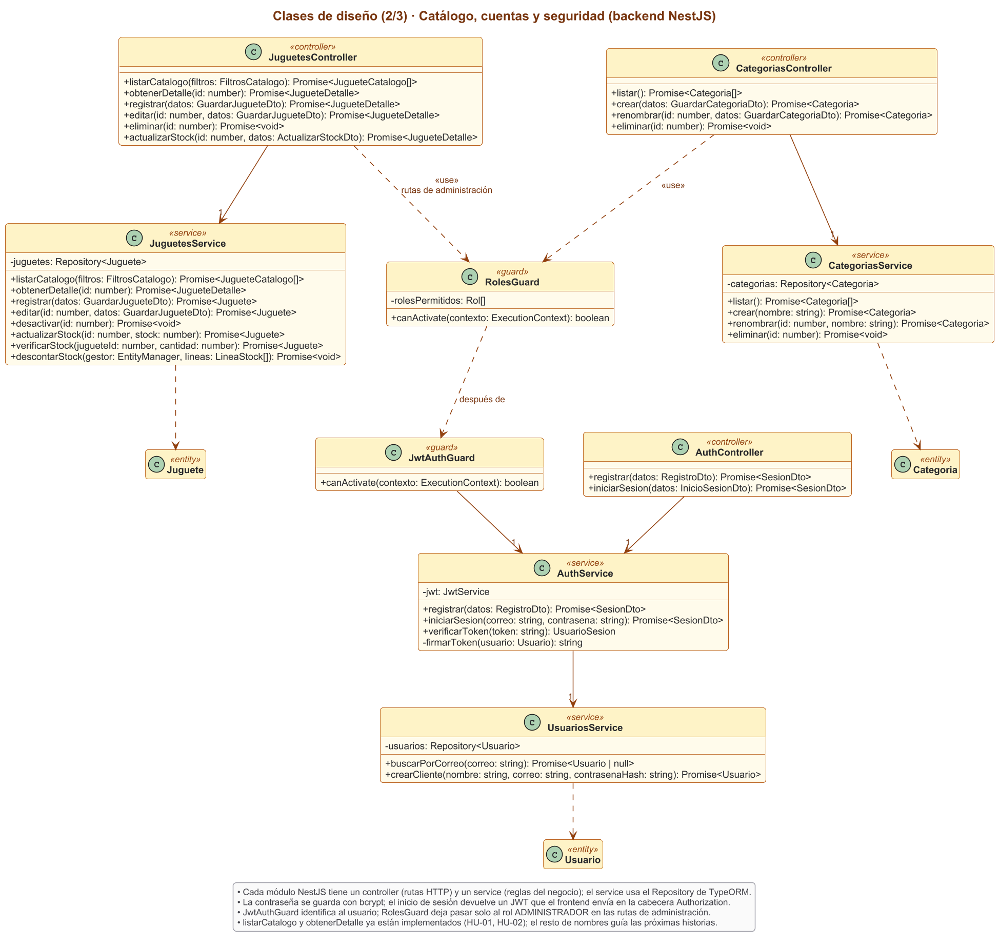


- **Usuario con rol.** Cliente y Administrador del análisis se diseñan como un solo `Usuario` con el atributo `rol` (enum `Rol`), igual que en el código. Comparten el registro y el inicio de sesión.
- **Controller + service.** Cada módulo de NestJS tiene un controller, que expone las rutas HTTP, y un service, que aplica las reglas del negocio usando el `Repository` de TypeORM.
- **Seguridad.** `JwtAuthGuard` identifica al usuario a partir del JWT, y `RolesGuard` deja pasar solo al rol ADMINISTRADOR. El `usuarioId` siempre sale del token, nunca del cuerpo de la petición.
- **Pago en una transacción.** `PagosService.pagar()` revisa la tarjeta y el pedido; si se aprueba, marca el pedido como Pagado (`PedidosService.marcarPagado`), descuenta el stock (`JuguetesService.descontarStock`) y guarda el `Pago` en una sola transacción. Si algo falla, no se guarda nada.
- **Ya implementado.** `JuguetesController` y `JuguetesService` con `listarCatalogo` y `obtenerDetalle` (HU-01, HU-02); `AuthController`, `AuthService` y `UsuariosService` con `registrar` (HU-03) e `iniciarSesion` (HU-04); `JwtAuthGuard`, `AuthService.verificarToken`, `JuguetesService.verificarStock` y `CarritoController`/`CarritoService` con `obtener` y `agregar` (HU-05), y con `cambiarCantidad` y `quitar`/`quitarItem` (HU-06); `Carrito.calcularTotal` e `ItemCarrito.calcularSubtotal` (HU-07); `PedidosController`/`PedidosService` con `generar`/`generarPedido` y `obtenerMio`/`obtenerPedido`, `CarritoService.vaciar` y las entidades `Pedido`, `DetallePedido` y `DatosEntrega` (HU-08); `PagosController`/`PagosService` con `pagar`, `PedidosService.marcarPagado`, `JuguetesService.descontarStock` y la entidad `Pago` (HU-09). El resto de nombres guía las próximas historias.
- **El hash no sale de la base de datos.** La columna `contrasena_hash` tiene `select: false`: solo `UsuariosService.buscarConContrasena` la lee, y solo para el inicio de sesión.

## 5. Subsistemas con interfaces

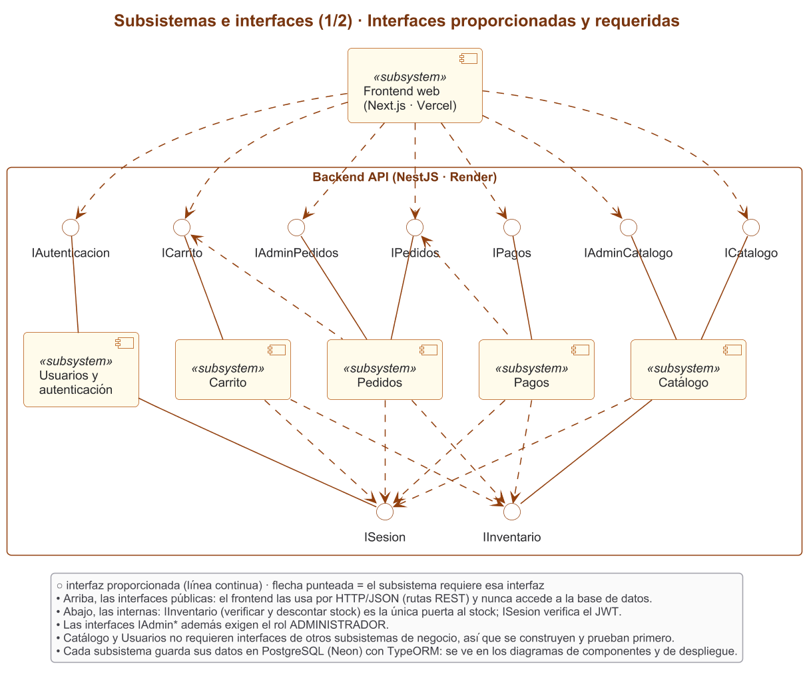

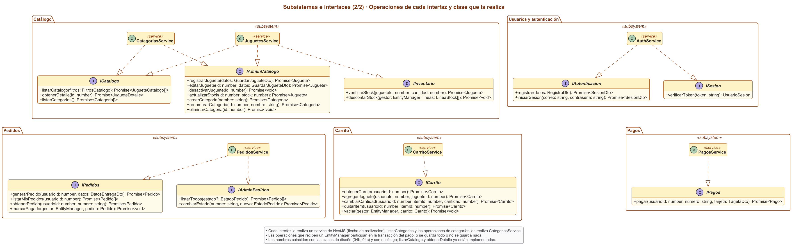

- **Interfaces públicas** (arriba): el frontend las usa por HTTP/JSON y nunca accede a la base de datos. **Interfaces internas** (abajo): `IInventario` y `ISesion`.
- **`IInventario`** es la única puerta al stock: Carrito, Pedidos y Pagos verifican y descuentan unidades a través de Catálogo.
- **Sin ciclos:** Catálogo y Usuarios no requieren interfaces de otros subsistemas de negocio. Carrito requiere Catálogo, Pedidos requiere Carrito, y Pagos requiere Pedidos.
- Cada interfaz la realiza un service de NestJS, con los mismos nombres de operación que en las clases de diseño.

## Trazabilidad del análisis al diseño

| Control (análisis) | Clases de diseño | Interfaz que realiza |
|---|---|---|
| ControlCatalogo | JuguetesController, JuguetesService, CategoriasService | ICatalogo |
| ControlCuentas | AuthController, AuthService, UsuariosService | IAutenticacion, ISesion |
| ControlCarrito | CarritoController, CarritoService | ICarrito |
| ControlPedidos | PedidosController, PedidosService | IPedidos |
| ControlPago | PagosController, PagosService | IPagos |
| ControlAdminCatalogo | JuguetesController, CategoriasController (rutas con RolesGuard) | IAdminCatalogo, IInventario |
| ControlAdminPedidos | PedidosController (rutas con RolesGuard) | IAdminPedidos |

## 6. Secuencia

Cada diagrama de secuencia se hace junto con la historia que implementa su caso de uso, con los mismos nombres de clases y métodos que el código. La excepción es CU-12 Gestionar productos (06d y 06e): sus historias (HU-12 y HU-20) son de la release v2.0, así que su diagrama es el diseño que guiará esa implementación, con los nombres de las clases de diseño (04b) y de las interfaces (05b).

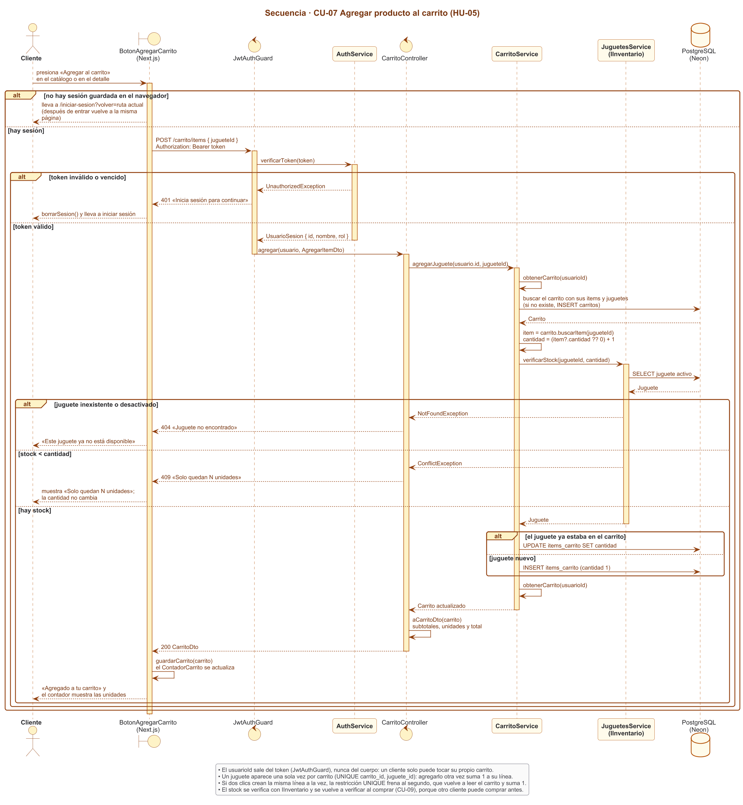

- **CU-07 Agregar producto al carrito (HU-05).** El botón de la tienda llama a `POST /carrito/items`; `JwtAuthGuard` verifica el token con `AuthService.verificarToken` (ISesion) y `CarritoService.agregarJuguete` verifica el stock con `JuguetesService.verificarStock` (IInventario) antes de guardar.
- **Fragmentos `alt`.** Sin sesión, la tienda lleva a iniciar sesión y después vuelve a la misma página; con el token vencido responde 401; sin stock responde 409 «Solo quedan N unidades» y la cantidad no cambia.
- **Una línea por juguete.** Agregar otra vez el mismo juguete actualiza la cantidad de su línea (`UPDATE`); un juguete nuevo crea la línea con cantidad 1 (`INSERT`).

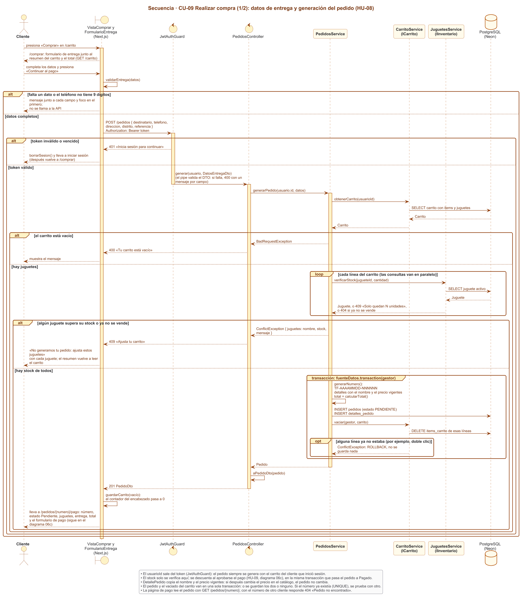

- **CU-09 Realizar compra (HU-08).** La página `/comprar` valida el formulario de entrega antes de llamar a `POST /pedidos`; `PedidosService.generarPedido` lee el carrito con `CarritoService` (ICarrito) y verifica el stock de cada línea con `JuguetesService.verificarStock` (IInventario).
- **Fragmentos `alt`.** Un dato que falta o un teléfono sin 9 dígitos se corrige en el formulario; con el carrito vacío responde 400; si algún juguete supera su stock responde 409 con la lista de juguetes que hay que ajustar y no se genera el pedido.
- **Una sola transacción.** El pedido Pendiente, sus detalles con el precio vigente y el vaciado del carrito se guardan juntos o no se guarda nada (`opt`: un doble clic encuentra el carrito ya vacío y se deshace). El pago sigue en el diagrama 06c.

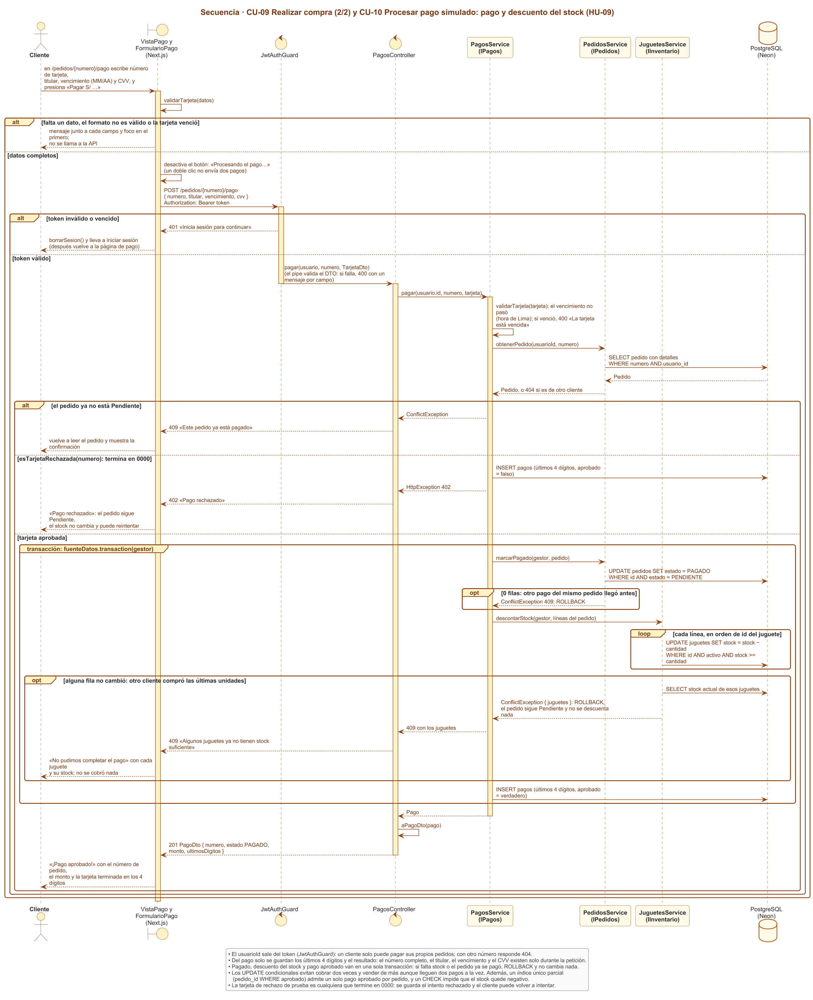

- **CU-09 (2/2) y CU-10 Procesar pago simulado (HU-09).** «Realizar compra» se divide en dos vistas para que cada una se lea completa. En la página de pago, `FormularioPago` valida la tarjeta antes de llamar a `POST /pedidos/{numero}/pago`; `PagosService.pagar` busca el pedido con `PedidosService` (IPedidos) y descuenta el stock con `JuguetesService` (IInventario).
- **Fragmentos `alt`.** Datos mal escritos o tarjeta vencida: 400 por campo; pedido ya pagado: 409; tarjeta que termina en 0000: 402 «Pago rechazado», se guarda el intento y el cliente puede reintentar.
- **Una sola transacción.** Pedido Pagado, descuento del stock y pago aprobado se guardan juntos o nada (`opt`: otro pago que llegó antes o un juguete sin stock hacen ROLLBACK). Del pago solo se guardan los últimos 4 dígitos y el resultado.

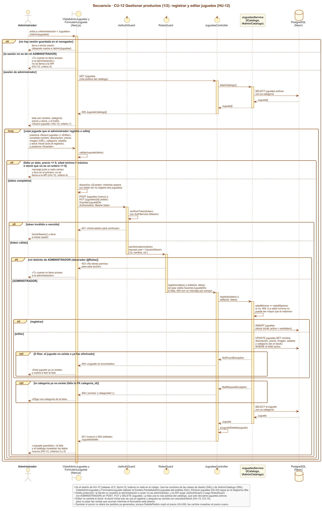

- **CU-12 Gestionar productos (1/2): registrar y editar (HU-12).** En `/admin/juguetes`, `FormularioJuguete` valida los datos antes de llamar a `POST /juguetes` o `PUT /juguetes/{id}`; la API exige `JwtAuthGuard` y después `RolesGuard` (rol ADMINISTRADOR), y `JuguetesService.registrar` o `editar` guarda el juguete. «Gestionar productos» también se divide en dos vistas.
- **Fragmentos `loop`, `alt` y `opt`.** El `loop` repite el registro o la edición por cada juguete. Los `alt` cubren a quien no es administrador (la tienda no muestra la administración y la API responde 403), el token vencido (401) y los datos inválidos. Los `opt` cubren el juguete eliminado mientras se editaba (404) y la categoría que ya no existe (400).
- **Editar no toca el stock.** El stock inicial solo se usa al registrar; después cambia con `actualizarStock` (HU-13), para no pisar las ventas que ocurran mientras el formulario está abierto.

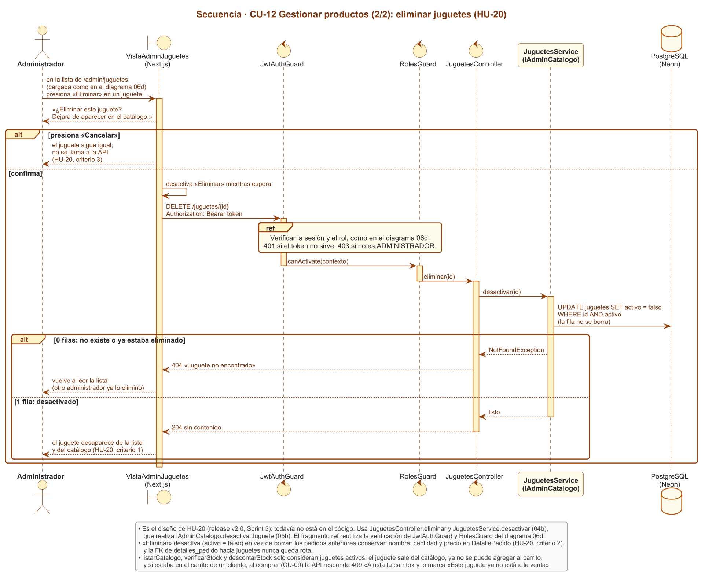

- **CU-12 Gestionar productos (2/2): eliminar (HU-20).** Después de confirmar, la tienda llama a `DELETE /juguetes/{id}` y `JuguetesService.desactivar` pone `activo = falso`: no se borra la fila, así que los pedidos anteriores conservan sus datos.
- **Fragmentos `alt` y `ref`.** Cancelar no llama a la API; un juguete que ya estaba eliminado responde 404. El `ref` reutiliza la verificación de sesión y rol del diagrama 06d.
- **Efecto en la compra.** El catálogo, el carrito y la compra solo consideran juguetes activos: si el juguete estaba en un carrito, al comprar la API responde 409 «Ajusta tu carrito» y lo marca «Este juguete ya no está a la venta».

## 7. Implementación

Los componentes y los artefactos salen de la estructura real del repositorio: cada componente es una carpeta de `frontend/src` o `backend/src`, y cada artefacto es un archivo del repositorio o uno que genera la compilación.

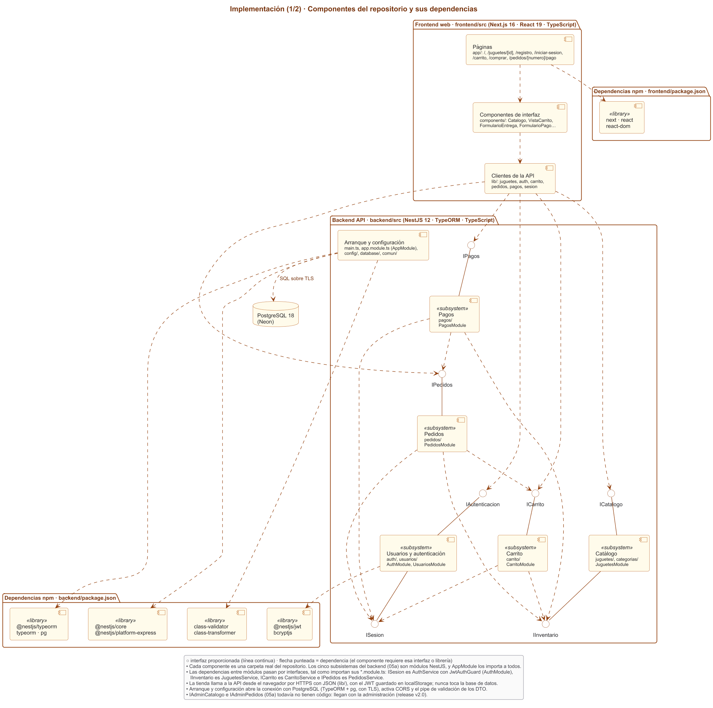

- **Cinco subsistemas, cinco módulos NestJS.** Usuarios y autenticación (`auth/`, `usuarios/`), Catálogo (`juguetes/`, `categorias/`), Carrito, Pedidos y Pagos son los subsistemas del diagrama 05a; `AppModule` los importa a todos.
- **Dependencias por interfaces.** Cada flecha sale de lo que importa un `*.module.ts`: Carrito requiere ISesion e IInventario; Pedidos, además, ICarrito; Pagos, además, IPedidos. ISesion es `AuthService` con `JwtAuthGuard`, e IInventario es `JuguetesService`.
- **Frontend.** Las páginas de `app/` usan los componentes de `components/`, y estos llaman a la API con los clientes de `lib/`. Las librerías npm de cada lado salen de su `package.json`.

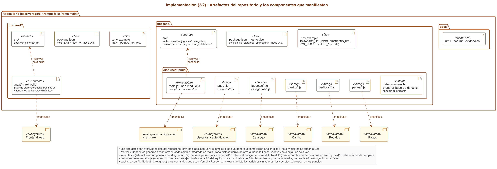

- **«manifest».** Cada carpeta compilada de `backend/dist/` manifiesta el módulo del mismo nombre, `dist/main.js` manifiesta el arranque y `.next/` manifiesta la tienda completa.
- **Lo que no se sube a Git.** `.next/` y `dist/` se generan con `next build` y `nest build` («derive»); Vercel y Render los compilan desde `src/` en cada cambio integrado en `main`.
- **Configuración sin secretos.** `package.json` fija Node 24.x y los comandos de compilación; `.env.example` lista los nombres de las variables, y sus valores solo están en los paneles de Vercel y Render.

## 8 y 9. Despliegue

Los dos diagramas muestran el despliegue real de producción: la tienda en Vercel, la API en Render y la base de datos en Neon. El descriptor (08) muestra los tipos de nodo y los atributos de configuración; la instancia (09), los nodos concretos con sus valores.

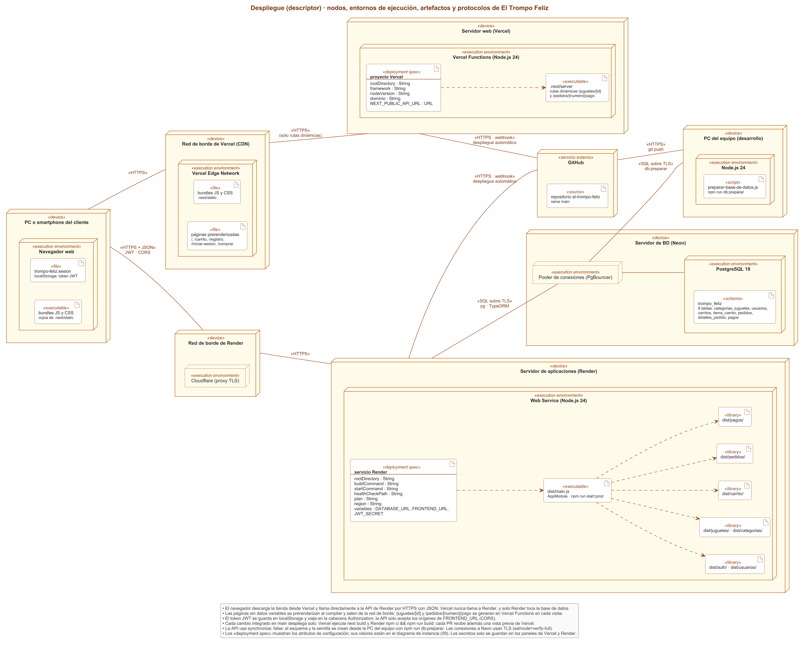

- **Nodos y entornos de ejecución.** Cliente con su navegador, red de borde de Vercel (CDN), Vercel Functions (Node.js 24), red de borde de Render (Cloudflare), Web Service de Render (Node.js 24), Neon (pooler PgBouncer y PostgreSQL 18), GitHub y la PC del equipo.
- **Artefactos desplegados.** Las páginas prerenderizadas y `.next/static` van a la red de borde; `.next/server` (rutas dinámicas), a Vercel Functions; `dist/main.js` y la carpeta compilada de cada módulo, a Render; el esquema `trompo_feliz`, a PostgreSQL. Cada servidor tiene su «deployment spec».
- **Protocolos.** El navegador usa HTTPS con Vercel y HTTPS + JSON con la API (JWT en la cabecera Authorization, CORS limitado a `FRONTEND_URL`); la API y `npm run db:preparar` usan SQL sobre TLS con Neon; GitHub avisa a Vercel y a Render por webhook HTTPS para desplegar.

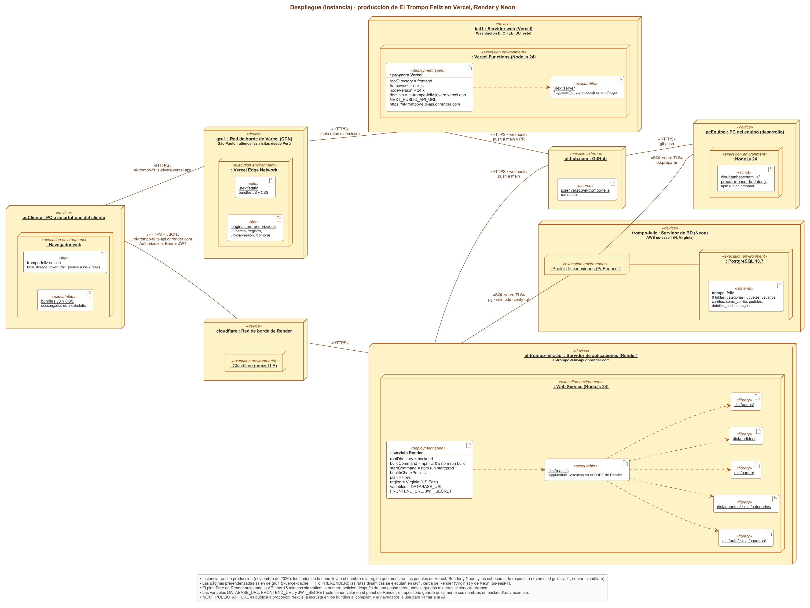

- **Valores reales.** `el-trompo-feliz-jrivera.vercel.app` (borde `gru1`, funciones en `iad1`), `el-trompo-feliz-api.onrender.com` (plan Free, Virginia, health check `/`) y Neon `trompo-feliz` en AWS us-east-1 con PostgreSQL 18.7.
- **Cómo se comprobó.** Con las cabeceras de respuesta (`x-vercel-id`, `x-vercel-cache`, `server: cloudflare`), la configuración de cada panel y la versión que devuelve PostgreSQL. La URL de la API es la que Next.js incrustó en los bundles de producción.
- **Sin secretos.** De `DATABASE_URL`, `FRONTEND_URL` y `JWT_SECRET` solo se muestran los nombres.
