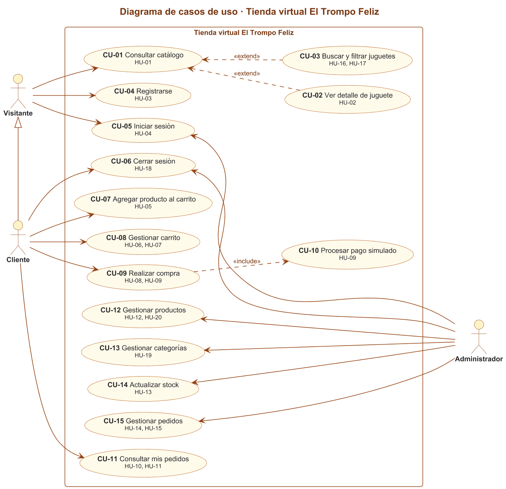
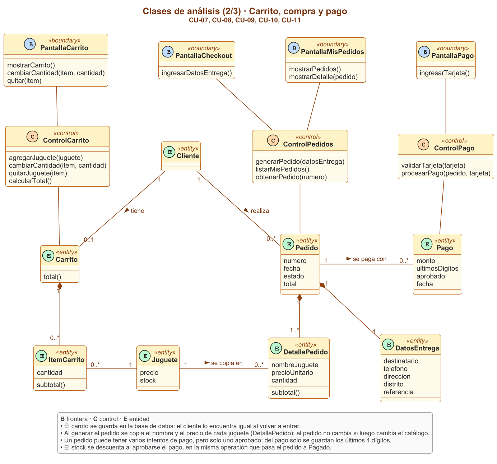
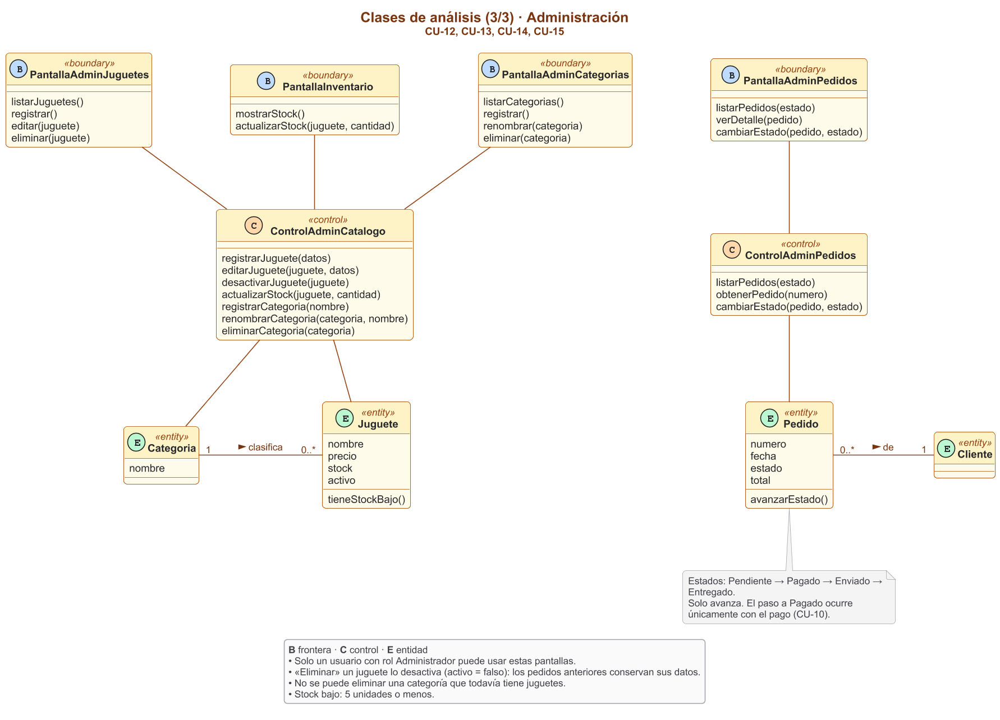
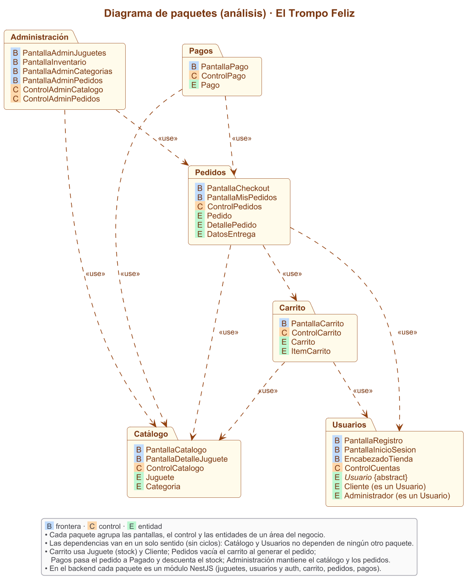
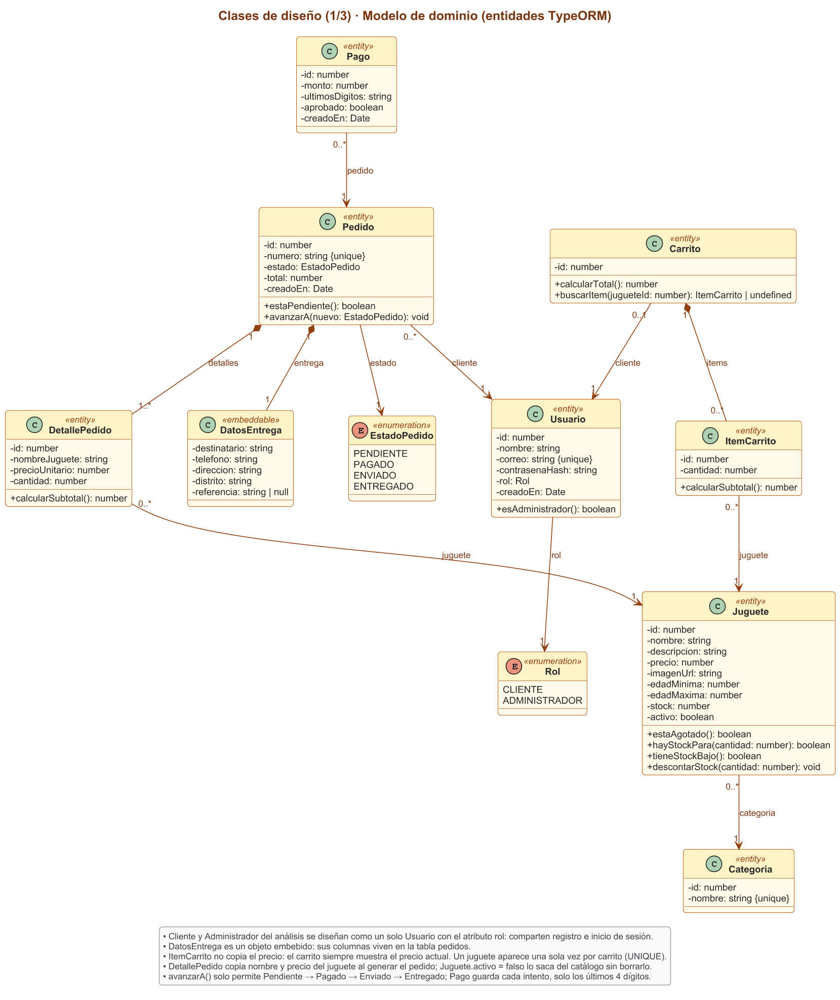
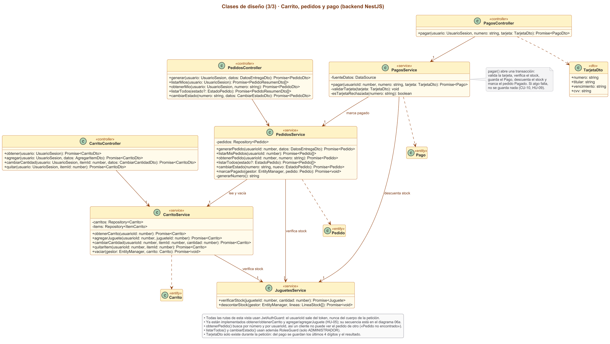

# Diagramas UML

Fuentes en PlantUML (`.puml`) y sus imágenes en [`png/`](png/). Cada diagrama usa los mismos nombres que las historias de usuario, los casos de uso y el código.

| # | Diagrama | Modelo | Tarea | Archivos |
|---|---|---|---|---|
| 1 | Casos de uso | Requisitos | ETF-31 | [01-casos-de-uso](png/01-casos-de-uso.png) |
| 2 | Clases de análisis (boundary, control, entity) | Análisis | ETF-31 | [02a catálogo y cuentas](png/02a-clases-analisis-catalogo-cuentas.png) · [02b compra](png/02b-clases-analisis-compra.png) · [02c administración](png/02c-clases-analisis-administracion.png) |
| 3 | Paquetes | Análisis | ETF-31 | [03-paquetes](png/03-paquetes.png) |
| 4 | Clases de diseño | Diseño | ETF-32 | [04a dominio](png/04a-clases-diseno-dominio.png) · [04b catálogo y cuentas](png/04b-clases-diseno-catalogo-cuentas.png) · [04c compra](png/04c-clases-diseno-compra.png) |
| 5 | Subsistemas con interfaces | Diseño | ETF-32 | [05a interfaces](png/05a-subsistemas-interfaces.png) · [05b operaciones](png/05b-subsistemas-operaciones.png) |
| 6 | Secuencia: Agregar producto al carrito, Realizar compra y Gestionar productos | Diseño | ETF-33 | [06a agregar al carrito](png/06a-secuencia-agregar-carrito.png) · realizar compra y gestionar productos: pendientes |
| 7 | Componentes y artefactos | Implementación | ETF-34 | |
| 8 | Despliegue (descriptor) | Despliegue | ETF-34 | |
| 9 | Despliegue (instancia) | Despliegue | ETF-34 | |

## Cómo regenerar las imágenes

Se necesita Java, [PlantUML](https://plantuml.com/download) (`plantuml.jar`) y [Graphviz](https://graphviz.org/download/). Todos los diagramas incluyen [`estilo.iuml`](estilo.iuml), con los colores de la tienda.

```powershell
./generar.ps1 -PlantUml C:\ruta\plantuml.jar -Dot C:\ruta\graphviz\bin\dot.exe
```

## 1. Casos de uso



- **Actores.** El Visitante navega sin cuenta. El Cliente es un Visitante que inició sesión, así que hereda sus casos de uso. El Administrador gestiona el catálogo y los pedidos.
- **Trazabilidad.** Cada caso de uso indica las historias de usuario que lo implementan (HU-01 … HU-20), igual que el [product backlog](../scrum/product-backlog.md).
- **«extend».** Ver el detalle (CU-02) y buscar o filtrar (CU-03) son opcionales a partir del catálogo (CU-01).
- **«include».** Realizar compra (CU-09) siempre incluye el pago simulado (CU-10): el pedido queda Pendiente hasta que se paga.

## 2. Clases de análisis

Se dividen en tres vistas para que cada una se lea bien. **B** = frontera (pantalla), **C** = control (lógica del caso de uso), **E** = entidad (dato que se guarda).






- Cada pantalla habla con un solo control, y las entidades no conocen a las pantallas.
- El carrito se guarda en la base de datos, así que el cliente lo encuentra igual cuando vuelve a entrar.
- DetallePedido copia el nombre y el precio del juguete, por eso un pedido no cambia si después cambia el catálogo. Por la misma razón, «eliminar» un juguete solo lo desactiva.
- Un pedido puede tener varios intentos de pago, pero solo uno aprobado. Al aprobarse el pago se descuenta el stock en la misma operación, y el pedido solo avanza: Pendiente → Pagado → Enviado → Entregado.

## 3. Paquetes



- Cada paquete agrupa las pantallas, el control y las entidades de un área del negocio.
- Las dependencias van en un solo sentido, sin ciclos. Catálogo y Usuarios son la base y no dependen de ningún otro paquete.
- Cada paquete corresponde a un módulo del backend NestJS y a una carpeta de páginas del frontend (ver la tabla siguiente).

## Trazabilidad del análisis al código

| Paquete | Casos de uso | Controles de análisis | Módulo del backend | Páginas del frontend |
|---|---|---|---|---|
| Catálogo | CU-01, CU-02, CU-03 | ControlCatalogo | `backend/src/juguetes` (hecho), `categorias` | `/`, `/juguetes/[id]` (hechas) |
| Usuarios | CU-04, CU-05, CU-06 | ControlCuentas | `backend/src/usuarios`, `auth` (registro, inicio de sesión y `JwtAuthGuard` hechos) | `/registro`, `/iniciar-sesion` (hechas) |
| Carrito | CU-07, CU-08 | ControlCarrito | `backend/src/carrito` (agregar hecho) | botón «Agregar al carrito» y contador (hechos), `/carrito` |
| Pedidos | CU-09, CU-11 | ControlPedidos | `backend/src/pedidos` | `/checkout`, `/mis-pedidos` |
| Pagos | CU-10 | ControlPago | `backend/src/pagos` | `/pago/[numero]` |
| Administración | CU-12 … CU-15 | ControlAdminCatalogo, ControlAdminPedidos | rutas protegidas para el rol ADMINISTRADOR en `juguetes`, `categorias` y `pedidos` | `/admin/...` |

## 4. Clases de diseño

Tres vistas: el modelo de dominio (entidades de TypeORM) y los controllers y services de NestJS que lo usan. Llevan tipos de TypeScript, visibilidad (`+` pública, `-` privada) y multiplicidades.






- **Usuario con rol.** Cliente y Administrador del análisis se diseñan como un solo `Usuario` con el atributo `rol` (enum `Rol`), igual que en el código. Comparten el registro y el inicio de sesión.
- **Controller + service.** Cada módulo de NestJS tiene un controller, que expone las rutas HTTP, y un service, que aplica las reglas del negocio usando el `Repository` de TypeORM.
- **Seguridad.** `JwtAuthGuard` identifica al usuario a partir del JWT, y `RolesGuard` deja pasar solo al rol ADMINISTRADOR. El `usuarioId` siempre sale del token, nunca del cuerpo de la petición.
- **Pago en una transacción.** `PagosService.pagar()` valida la tarjeta, verifica el stock, guarda el `Pago`, descuenta el stock y marca el pedido como Pagado en una sola transacción.
- **Ya implementado.** `JuguetesController` y `JuguetesService` con `listarCatalogo` y `obtenerDetalle` (HU-01, HU-02); `AuthController`, `AuthService` y `UsuariosService` con `registrar` (HU-03) e `iniciarSesion` (HU-04); `JwtAuthGuard`, `AuthService.verificarToken`, `JuguetesService.verificarStock` y `CarritoController`/`CarritoService` con `obtener` y `agregar` (HU-05). El resto de nombres guía las próximas historias.
- **El hash no sale de la base de datos.** La columna `contrasena_hash` tiene `select: false`: solo `UsuariosService.buscarConContrasena` la lee, y solo para el inicio de sesión.

## 5. Subsistemas con interfaces


- **Interfaces públicas** (arriba): el frontend las usa por HTTP/JSON y nunca accede a la base de datos. **Interfaces internas** (abajo): `IInventario` y `ISesion`.
- **`IInventario`** es la única puerta al stock: Carrito, Pedidos y Pagos verifican y descuentan unidades a través de Catálogo.
- **Sin ciclos:** Catálogo y Usuarios no requieren interfaces de otros subsistemas de negocio. Carrito requiere Catálogo, Pedidos requiere Carrito, y Pagos requiere Pedidos.
- Cada interfaz la realiza un service de NestJS, con los mismos nombres de operación que en las clases de diseño.

## Trazabilidad del análisis al diseño

| Control (análisis) | Clases de diseño | Interfaz que realiza |
|---|---|---|
| ControlCatalogo | JuguetesController, JuguetesService, CategoriasService | ICatalogo |
| ControlCuentas | AuthController, AuthService, UsuariosService | IAutenticacion, ISesion |
| ControlCarrito | CarritoController, CarritoService | ICarrito |
| ControlPedidos | PedidosController, PedidosService | IPedidos |
| ControlPago | PagosController, PagosService | IPagos |
| ControlAdminCatalogo | JuguetesController, CategoriasController (rutas con RolesGuard) | IAdminCatalogo, IInventario |
| ControlAdminPedidos | PedidosController (rutas con RolesGuard) | IAdminPedidos |

## 6. Secuencia

Cada diagrama de secuencia se hace junto con la historia que implementa su caso de uso, con los mismos nombres de clases y métodos que el código.


- **CU-07 Agregar producto al carrito (HU-05).** El botón de la tienda llama a `POST /carrito/items`; `JwtAuthGuard` verifica el token con `AuthService.verificarToken` (ISesion) y `CarritoService.agregarJuguete` verifica el stock con `JuguetesService.verificarStock` (IInventario) antes de guardar.
- **Fragmentos `alt`.** Sin sesión, la tienda lleva a iniciar sesión y después vuelve a la misma página; con el token vencido responde 401; sin stock responde 409 «Solo quedan N unidades» y la cantidad no cambia.
- **Una línea por juguete.** Agregar otra vez el mismo juguete actualiza la cantidad de su línea (`UPDATE`); un juguete nuevo crea la línea con cantidad 1 (`INSERT`).
