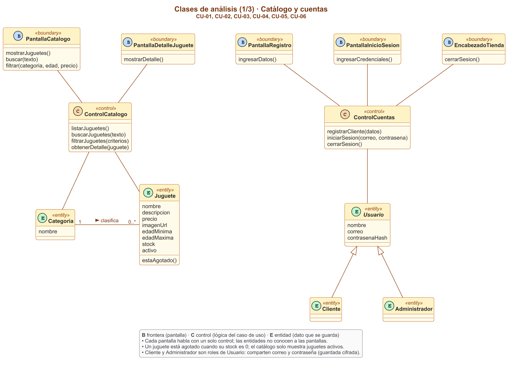

# Diagramas UML

Fuentes en PlantUML (`.puml`) y sus imágenes en [`png/`](png/). Cada diagrama usa los mismos nombres que las historias de usuario, los casos de uso y el código.

| # | Diagrama | Modelo | Tarea | Archivos |
|---|---|---|---|---|
| 1 | Casos de uso | Requisitos | ETF-31 | [01-casos-de-uso](png/01-casos-de-uso.png) |
| 2 | Clases de análisis (boundary, control, entity) | Análisis | ETF-31 | [02a catálogo y cuentas](png/02a-clases-analisis-catalogo-cuentas.png) · [02b compra](png/02b-clases-analisis-compra.png) · [02c administración](png/02c-clases-analisis-administracion.png) |
| 3 | Paquetes | Análisis | ETF-31 | [03-paquetes](png/03-paquetes.png) |
| 4 | Clases de diseño | Diseño | ETF-32 | |
| 5 | Subsistemas con interfaces | Diseño | ETF-32 | |
| 6 | Secuencia: Agregar producto al carrito, Realizar compra y Gestionar productos | Diseño | ETF-33 | |
| 7 | Componentes y artefactos | Implementación | ETF-34 | |
| 8 | Despliegue (descriptor) | Despliegue | ETF-34 | |
| 9 | Despliegue (instancia) | Despliegue | ETF-34 | |

## Cómo regenerar las imágenes

Se necesita Java, [PlantUML](https://plantuml.com/download) (`plantuml.jar`) y [Graphviz](https://graphviz.org/download/). Todos los diagramas incluyen [`estilo.iuml`](estilo.iuml), con los colores de la tienda.

```powershell
./generar.ps1 -PlantUml C:\ruta\plantuml.jar -Dot C:\ruta\graphviz\bin\dot.exe
```

## 1. Casos de uso


- **Actores.** El Visitante navega sin cuenta. El Cliente es un Visitante que inició sesión, así que hereda sus casos de uso. El Administrador gestiona el catálogo y los pedidos.
- **Trazabilidad.** Cada caso de uso indica las historias de usuario que lo implementan (HU-01 … HU-20), igual que el [product backlog](../scrum/product-backlog.md).
- **«extend».** Ver el detalle (CU-02) y buscar o filtrar (CU-03) son opcionales a partir del catálogo (CU-01).
- **«include».** Realizar compra (CU-09) siempre incluye el pago simulado (CU-10): el pedido queda Pendiente hasta que se paga.

## 2. Clases de análisis

Se dividen en tres vistas para que cada una se lea bien. **B** = frontera (pantalla), **C** = control (lógica del caso de uso), **E** = entidad (dato que se guarda).




- Cada pantalla habla con un solo control, y las entidades no conocen a las pantallas.
- El carrito se guarda en la base de datos, así que el cliente lo encuentra igual cuando vuelve a entrar.
- DetallePedido copia el nombre y el precio del juguete, por eso un pedido no cambia si después cambia el catálogo. Por la misma razón, «eliminar» un juguete solo lo desactiva.
- Un pedido puede tener varios intentos de pago, pero solo uno aprobado. Al aprobarse el pago se descuenta el stock en la misma operación, y el pedido solo avanza: Pendiente → Pagado → Enviado → Entregado.

## 3. Paquetes


- Cada paquete agrupa las pantallas, el control y las entidades de un área del negocio.
- Las dependencias van en un solo sentido, sin ciclos. Catálogo y Usuarios son la base y no dependen de ningún otro paquete.
- Cada paquete corresponde a un módulo del backend NestJS y a una carpeta de páginas del frontend (ver la tabla siguiente).

## Trazabilidad del análisis al código

| Paquete | Casos de uso | Controles de análisis | Módulo del backend | Páginas del frontend |
|---|---|---|---|---|
| Catálogo | CU-01, CU-02, CU-03 | ControlCatalogo | `backend/src/juguetes` (hecho), `categorias` | `/`, `/juguetes/[id]` (hechas) |
| Usuarios | CU-04, CU-05, CU-06 | ControlCuentas | `backend/src/usuarios` (entidad hecha), `auth` | `/registro`, `/iniciar-sesion` |
| Carrito | CU-07, CU-08 | ControlCarrito | `backend/src/carrito` | `/carrito` |
| Pedidos | CU-09, CU-11 | ControlPedidos | `backend/src/pedidos` | `/checkout`, `/mis-pedidos` |
| Pagos | CU-10 | ControlPago | `backend/src/pagos` | `/pago/[numero]` |
| Administración | CU-12 … CU-15 | ControlAdminCatalogo, ControlAdminPedidos | rutas protegidas para el rol ADMINISTRADOR en `juguetes`, `categorias` y `pedidos` | `/admin/...` |
